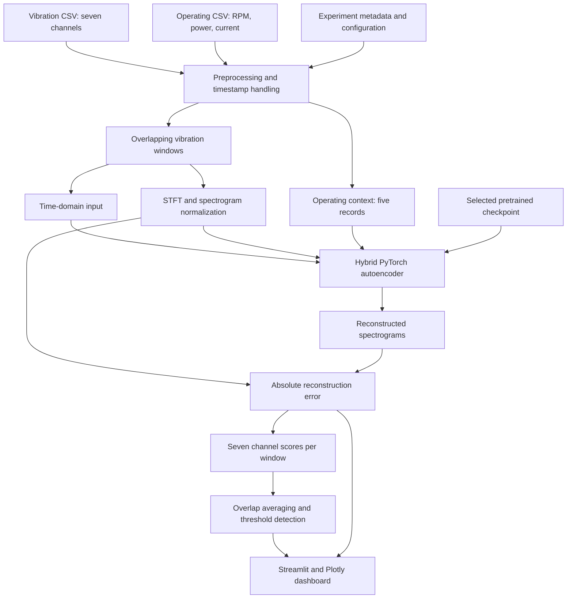

# Multi-Channel Vibration Anomaly Detection Dashboard

**Initial demo proposal | Machine condition monitoring using deep learning**

This project turns recorded vibration and machine operating data into an interactive dashboard for investigating unusual equipment behavior. It combines seven vibration channels with rotational speed, power, and current, then uses a pretrained PyTorch model to reconstruct frequency patterns. Differences between measured and reconstructed patterns become anomaly scores that engineers can inspect over time.

The initial demo demonstrates the workflow from local experiment files to visual investigation. It provides a foundation for a future condition monitoring application, with opportunities to improve presentation, evaluation, performance, and integration with live equipment.

## Contents

- [Purpose and proposal](#purpose-and-proposal)
- [What the current demo does](#what-the-current-demo-does)
- [How we built the application](#how-we-built-the-application)
- [How the analysis works](#how-the-analysis-works)
- [Dashboard outputs and interpretation](#dashboard-outputs-and-interpretation)
- [Benefits and expected value](#benefits-and-expected-value)
- [Project structure and data requirements](#project-structure-and-data-requirements)
- [Running the demo](#running-the-demo)
- [Suggested demo walkthrough](#suggested-demo-walkthrough)
- [Current scope and limitations](#current-scope-and-limitations)
- [Future visual and interaction improvements](#future-visual-and-interaction-improvements)
- [Development roadmap](#development-roadmap)

## Purpose and proposal

### The problem

High-frequency vibration measurements contain information about changing machine behavior. Reviewing raw CSV files or isolated signal plots makes it difficult to connect a change with its timing, affected sensor, and operating conditions.

For the powder handling and motor experiments represented in this project, the practical questions are:

- When does the recorded behavior become unusual?
- Which vibration channels show the strongest deviation?
- Does the unusual behavior coincide with a known experimental event?
- What frequency patterns contributed to the model's score?
- How does the interpretation change when the detection threshold changes?

### The proposed solution

Provide one application that connects the vibration signal, anomaly score, detection timeline, and model reconstruction. Users can select a saved model and experiment, run analysis, and investigate the most unusual windows without moving between separate scripts.

The intended users are maintenance engineers, equipment specialists, researchers, and stakeholders deciding whether the approach should advance to a larger pilot.

### Initial demo objectives

| Objective | What the demo makes reviewable |
| --- | --- |
| Demonstrate the analysis workflow | Local files progress through preprocessing, inference, scoring, and visualization. |
| Support engineering investigation | Users inspect individual channels and compare original and reconstructed spectrograms. |
| Explain detection decisions | A visible threshold connects a numerical score to the abnormal flag. |
| Compare experimental scenarios | Six configured recordings cover powder handling, restart, and motor-related experiments. |
| Establish a development foundation | Separate modules support later changes to the model, preprocessing, and interface. |

The proposal is for a decision support tool. An elevated anomaly score identifies a pattern to investigate. Identifying a specific mechanical fault or forecasting remaining machine life would require additional development and validation.

## What the current demo does

| Capability | Current implementation |
| --- | --- |
| Model selection | Discovers `.pt` checkpoints in `models/` and lets the user select one. |
| Experiment selection | Offers six recordings defined in `FILE_MAP` in `config.py`. |
| Multi-channel analysis | Processes seven vibration channels together and produces separate channel scores. |
| Operating context | Includes five operating records containing RPM, power, and current for each accepted window. |
| Device selection | Uses CUDA when available and otherwise falls back to CPU. |
| Batch inference | Offers batch sizes of 4, 8, 16, 32, or 64; the default is 32. |
| Threshold exploration | Supports Global optimized, Max normal, and Manual modes. |
| Interactive investigation | Shows timelines, channel comparisons, ranked windows, spectrograms, and summary tables. |
| Result reuse | Keeps inference output in Streamlit session state for channel and threshold exploration. |
| Model caching | Uses `st.cache_resource` to reuse the loaded model. |
| Replay controls | Sidebar settings exist, but timed playback is not connected to the rendering flow. |

The app currently analyzes recorded files. Live ingestion, external alarms, persistent analysis history, and automatic reporting are future capabilities.

## How we built the application

### Technology choices

| Technology | Role | Why it fits the demo |
| --- | --- | --- |
| Python | Connects data processing, inference, and interface code. | Keeps the complete workflow inspectable in one language. |
| Streamlit | Supplies controls, action buttons, status messages, charts, caching, and session state. | Supports an interactive engineering demo directly from Python. |
| PyTorch | Defines the network, loads checkpoints, calculates STFTs, and runs inference. | Supports the existing model and CUDA acceleration. |
| NumPy | Handles signal arrays, masks, scores, and overlap averaging. | Supports the numerical operations used throughout the pipeline. |
| pandas | Reads CSVs, parses timestamps, cleans values, and retrieves operating context. | Makes experiment data manageable as structured tables. |
| Plotly | Renders interactive timelines, heatmaps, and tables. | Supports zoom, hover inspection, and visual comparison. |
| Conda | Manages the preferred `pytorch-gpu` environment. | Keeps Python and the required GPU libraries together. |

The dependency files also include scientific utilities such as SciPy, Matplotlib, and scikit-learn. The main execution path relies primarily on the libraries above.

### Implementation approach

1. **Centralize settings.** `config.py` defines file mappings, channels, sampling and window settings, normalization constants, label intervals, and thresholds.
2. **Prepare the inputs.** `preprocessing.py` reads the experiment, cleans values, establishes timestamps, and creates windows with operating context.
3. **Rebuild the pretrained model.** `model_definition.py` defines the neural network and loads the selected checkpoint with strict parameter matching.
4. **Calculate scores.** `inference_utils.py` generates spectrograms, runs batches, measures reconstruction differences, and builds sample-level score curves.
5. **Present the evidence.** `visualization.py` builds the timelines, spectrogram comparisons, and tables.
6. **Connect the workflow.** `app.py` coordinates user selections, execution, caching, stored results, and display.
7. **Make startup repeatable.** `run.bat` activates `pytorch-gpu` and starts Streamlit through that environment's Python.

This repository contains inference and visualization code plus saved checkpoints. It does not contain the training pipeline, dataset split procedure, or scripts used to optimize thresholds. Those artifacts should be collected to document the complete model development history.

### System workflow



## How the analysis works

### 1. Load and clean the experiment

Each experiment folder contains vibration data, `screw_data.csv`, and `metadata.txt`.

Preprocessing checks required columns, converts vibration values to numbers, and fills missing numeric vibration values with interpolation and boundary filling. Operating rows where RPM, power, and current are all zero are treated as communication loss; their operating values are interpolated.

Absolute timestamps are derived from `Real_Time` and experiment metadata. Operating records are sorted by timestamp so each vibration window can retrieve the latest available context up to its ending time.

Configured intervals identify normal, ambiguous, and abnormal reference regions. These are manually configured experiment annotations, independent of the model's predictions. A recording labeled “Normal” in the selector can still contain annotated abnormal or ambiguous intervals.

The app currently enables outlier cleaning within configured normal regions: values below the 0.05th percentile or above the 99.95th percentile are replaced through interpolation. The time branch otherwise receives raw vibration amplitudes without time-domain normalization.

### 2. Create windows and operating context

| Setting | Current value | Meaning |
| --- | --- | --- |
| Sample rate | 10,240 Hz | Nominal samples per second per vibration channel. |
| Window length | 10,240 samples | Approximately one second at the configured rate. |
| Window stride | 3,072 samples | Approximately 0.3 seconds between window starts. |
| Window overlap | 70% | Adjacent windows share much of their signal content. |
| Vibration channels | 7 | All seven enter the shared time branch. |
| Operating context | 5 records | The latest five operating records at or before the window end. |

Five operating records are not necessarily five seconds; their duration depends on the operating data's sampling interval. Windows without sufficient valid operating context are skipped.

Operating values are normalized using the mean and standard deviation stored in `config.py`. These constants, feature order, and signal settings must match the selected checkpoint's training assumptions.

### 3. Build frequency representations

A short-time Fourier transform (STFT) describes how frequency content changes within each vibration window.

| STFT setting | Value |
| --- | --- |
| FFT length | 1,024 |
| Hann window length | 1,024 |
| Hop length | 256 |
| Center padding | Disabled |
| Output frequency bins | 513 |
| Output time frames | 37 |

The implementation calculates `10 * log10(abs(STFT) ** 2 + epsilon)`, clips values to the configured training range of `-56.970` to `29.164`, and maps them to `[-1, 1]`. This is a normalized log-power representation; the code does not apply a separate physical PSD calibration.

### 4. Combine time, frequency, and operating information

The model class is `MegaUniversalTime_ChannelWiseSpecAE`.

| Branch | Architecture | Information represented |
| --- | --- | --- |
| Shared time encoder | Two strided 1D convolution layers and three LSTM layers with hidden sizes 128, 64, and 32. | Temporal behavior across all seven channels. |
| Channel spectrogram encoders | One 2D convolution encoder per channel, using 32, 64, and 128 filters and a 128-value latent representation. | Frequency patterns specific to each channel. |
| Operating encoder | 1D convolutions with 16 and 32 filters, adaptive pooling, and a 32-value latent representation. | RPM, power, and current context. |
| Fusion and reconstruction | Each channel combines the three representations, uses a 128-value fusion layer, and reconstructs its spectrogram through transposed convolutions. | Expected frequency content informed by vibration and operating conditions. |

The architecture includes dropout configured at `0.550`, disabled during evaluation. The decoder uses a `tanh` output to match the normalized input range.

For a batch of `B` windows:

```text
Time-domain input:       (B, 10240, 7)
Spectrogram input:       (B, 7, 513, 37)
Operating context:      (B, 5, 3)
Reconstructed output:   (B, 7, 513, 37)
Window anomaly scores:  (B, 7)
```

### 5. Calculate anomaly scores

For each window and channel, the score is the mean absolute reconstruction difference:

```text
error_map = abs(original_spectrogram - reconstructed_spectrogram)
channel_score = mean(error_map across frequency bins and time frames)
```

A larger score means a larger reconstruction mismatch. It is an anomaly indicator, not a calibrated fault probability.

Inference uses evaluation mode and disables gradient calculations. CUDA inference can use automatic mixed precision; CPU inference follows the regular precision path.

### 6. Build detection timelines

Each window's score is assigned to the samples covered by that window. Scores are averaged where windows overlap. Samples covered by no accepted window retain `NaN` scores and are excluded from valid detections.

For the selected channel, a valid sample is marked abnormal when its averaged score is **strictly greater than** the selected threshold.

| Mode | Current behavior | Interpretation |
| --- | --- | --- |
| Global optimized | Uses fixed per-channel values in `GLOBAL_OPTIMIZED_THRESHOLDS`. | Configuration describes these as optimized for F1; the optimization procedure is outside this repository. |
| Max normal | Uses fixed per-channel values in `MAX_NORMAL_THRESHOLDS`. | Configuration describes these as maximum-normal thresholds. This does not guarantee zero false alarms on new data. |
| Manual | Uses the sidebar number input. | Allows sensitivity exploration. |

Channel and threshold changes can reuse stored inference output. Selecting a different recording or checkpoint requires another click on **Run inference**.

## Dashboard outputs and interpretation

| Area | What it shows | How to use it |
| --- | --- | --- |
| Main overview | Selected vibration signal, anomaly score with threshold, and detection timeline. | Relate unusual scores to the signal and recording time. |
| Reference shading | Green for configured normal regions, amber for ambiguous regions, red for abnormal regions. | Compare predictions with experiment annotations. |
| Detection summary | Counts, coverage, predicted proportions, and score statistics. | Understand how much data was analyzed and flagged. |
| All-feature scores | Seven score plots with configured Global optimized thresholds. | Compare channel behavior. |
| Top anomalous windows | Up to 20 windows ranked by selected-channel score. | Focus detailed inspection on high-scoring intervals. |
| Spectrogram inspection | Original, reconstruction, and absolute error map. | Inspect frequency/time differences. |
| Detailed statistics | Minimum, maximum, mean, and standard deviation of finite sample scores. | Compare score distributions between runs. |
| File information | Folder/file and signal, window, spectrogram, and score dimensions. | Check inputs and outputs during the demo. |

Detected-normal and detected-abnormal percentages use samples with finite covered scores outside ambiguous reference regions. They describe the prediction split within that subset; they are not accuracy, precision, recall, or F1 metrics.

The main overview interpolates missing scores for display continuity. Charts are also downsampled for rendering. Detection still uses the original computed scores: a continuous line does not prove every displayed time point was scored, and short peaks may be less visible at overview scale.

## Benefits and expected value

| Benefit | How the demo supports it | Evidence needed for a pilot |
| --- | --- | --- |
| Faster investigation | Combines signal, scores, ranked windows, and reconstruction evidence. | Measure investigation time with and without the dashboard. |
| Better operating context | Includes RPM, power, and current in the model. | Compare with vibration-only and simpler baseline methods. |
| Focused sensor review | Produces separate scores for seven channels. | Confirm interpretation with equipment specialists and sensor placement information. |
| Clearer communication | Makes threshold crossings and reconstruction differences visible. | Gather operator feedback on usefulness and readability. |
| Repeatable experiments | Uses centralized configuration and selectable checkpoints. | Add versioned run records and reproducible exports. |
| Potential maintenance value | Could help prioritize inspections when unusual patterns appear. | Validate detection quality, false-alarm burden, and useful lead time on unseen runs. |
| Flexible development | Separates configuration, preprocessing, inference, and display. | Extend the workflow to additional assets and operating regimes. |

Reduced downtime, lower maintenance cost, and earlier fault detection are potential outcomes to evaluate. The current demo does not establish quantified savings or a guaranteed detection rate.

## Project structure and data requirements

```text
streamlit_mega_dashboard/
|-- app.py                 # Streamlit interface and coordination
|-- config.py              # Paths, features, settings, labels, thresholds
|-- preprocessing.py       # Cleaning, timestamps, windows, context
|-- model_definition.py    # Network architecture and checkpoint loading
|-- inference_utils.py     # STFT, inference, scores, detection, summaries
|-- visualization.py       # Plotly figures and tables
|-- run.bat                # Windows launcher for pytorch-gpu
|-- environment.yml        # Conda environment specification
|-- requirements.txt       # Python package list
|-- README.md              # Proposal and operating guide
|-- models/
|   |-- rank_01_epoch_0209_ch0_F1_1.0000.pt
|   `-- rank_02_epoch_0322_ch0_F1_1.0000.pt
`-- data/
    |-- 01_
    |-- 02_
    |-- 03_300rpm_
    |-- 04_
    `-- 05_
```

Checkpoint filenames include an F1 value, but filenames alone do not establish independently verified performance.

| Input | Required content |
| --- | --- |
| Vibration CSV | `Time(s)`, `Real_Time`, `단축2(g)`, `Mod1-X(g)`, `Mod1-Y(g)`, `Mod1-Z(g)`, `Mod2-X(g)`, `Mod2-Y(g)`, `Mod2-Z(g)`. |
| `screw_data.csv` | `Timestamp`, `RPM`, `동력(kw)`, `전류(A)`. |
| `metadata.txt` | At least `base_date` and `start_time`, as `key: value` entries. |
| Checkpoint | Compatible state dictionary, or a dictionary containing `model_state_dict`. |

Illustrative metadata format; substitute the actual experiment date and start time:

```text
base_date: 2026-01-01
start_time: 09:00:00
```

To add a compatible recording, place it with its operating data and metadata under `data/`, update `FILE_MAP`, and define reference intervals when annotations are available. Changes to channel order, sampling, normalization, or operating features must be checked against training assumptions.

## Running the demo

### Preferred environment

Use the existing Conda environment **`pytorch-gpu`**.

During the initial startup investigation, the local setup was verified with Python `3.12.9`, PyTorch `2.8.0.dev20250405+cu128`, Streamlit `1.46.1`, and an NVIDIA GeForce RTX 5090 with CUDA available. These are observed versions, not pinned requirements.

Both checkpoints loaded and completed GPU inference on one real vibration window with a placeholder operating-context tensor. Dashboard startup and the launcher's HTTP health endpoint also passed. This was a smoke check, not full-recording validation of preprocessing, operating-data alignment, accuracy, latency, or memory use.

### Start from PowerShell

From this project folder:

```powershell
.\run.bat
```

The launcher activates `pytorch-gpu` through `%USERPROFILE%\anaconda3\condabin\conda.bat`. If Conda is installed elsewhere, update `DASHBOARD_CONDA` in `run.bat`.

Alternatively:

```powershell
conda activate pytorch-gpu
python -m streamlit run app.py
```

Open the local URL printed by Streamlit, usually `http://localhost:8501`. To use another port:

```powershell
.\run.bat --server.port 8502
```

### PyCharm configuration

| Setting | Value |
| --- | --- |
| Run target | Module name |
| Module name | `streamlit` |
| Parameters | `run app.py` |
| Working directory | This project folder |
| Interpreter | Existing `pytorch-gpu` interpreter |

### New environment setup

The included specification is a starting point for a new machine:

```powershell
conda env create -f environment.yml
conda activate pytorch-gpu
python -m streamlit run app.py
```

Skip environment creation if `pytorch-gpu` already exists. The YAML requests Python 3.11 and CUDA 12.4, which differ from the verified local setup. It is not an exact environment export; a fresh installation needs a PyTorch/CUDA build compatible with its GPU. `requirements.txt` is also unpinned and does not select the verified GPU build.

### Troubleshooting

| Symptom | Check or action |
| --- | --- |
| `No module named 'torch'` | Use `run.bat`, or activate `pytorch-gpu` and launch with `python -m streamlit`. A bare `streamlit` command may resolve to another installation. |
| Device shows `cpu` | Check CUDA availability in the preferred environment and GPU support in the installed PyTorch build. |
| No models found | Check for compatible `.pt` files in `models/`. |
| Missing files or columns | Compare paths and column names with `config.py` and the input requirements above. |
| No valid windows | Check recording length, numeric values, timestamp alignment, and availability of five operating records. |
| Memory exhaustion | Lower batch size. Full-file arrays and retained spectrograms also require substantial system RAM. |
| Results still belong to the previous recording | Click **Run inference** after changing the recording or checkpoint. |

Check the active interpreter and CUDA support:

```powershell
python -c "import sys, torch; print(sys.executable); print(torch.__version__); print(torch.cuda.is_available())"
```

## Suggested demo walkthrough

1. **Introduce the question.** Explain how the app helps investigate unusual vibration in recorded powder handling and motor experiments.
2. **Confirm the context.** Show device, checkpoint, recording, and channel. Explain that selection labels and reference intervals are distinct.
3. **Run the pipeline.** Explain the loading, preprocessing, and inference stages. Prepare a completed run before a presentation because full-file runtime has not been benchmarked.
4. **Read the overview.** Follow the signal, threshold crossing, and detection timeline at the same time location. Distinguish reference shading from predictions.
5. **Explore sensitivity.** Change channel or threshold and discuss the result without claiming a universally best threshold.
6. **Inspect evidence.** Select a high-scoring window and compare its original spectrogram, reconstruction, and error map.
7. **Compare experiments.** Select another file or checkpoint, rerun inference, and discuss differences across channels.
8. **Present the next version.** Introduce the visual redesign, working playback, independent evaluation, and future live-data integration.

## Current scope and limitations

These observations describe the source code and help define the next development phase.

| Area | Current behavior | Needed improvement |
| --- | --- | --- |
| Recorded data | Loads configured local files after a user action. | Validated uploads and, later, streaming ingestion. |
| Replay | Sidebar settings exist, but the overview uses `display_until_time=None` with no timed playback loop. | Working play, pause, seek, restart, and speed controls. |
| Time discontinuities | Gaps and reverse steps are counted and segments calculated, but the good-time mask marks all segment samples valid; window creation does not enforce segment boundaries. | Prevent windows crossing discontinuities and validate timestamp formats and alignment. |
| Label-dependent cleaning | Outlier cleaning uses configured normal reference intervals. | An inference preprocessing policy that also works without labels. |
| Threshold consistency | Selected-channel detection follows the chosen mode; all-feature charts always show Global optimized thresholds. | Clear active-policy labeling and consistent thresholds across views. |
| Result identity | Results persist when selectors change; file information uses the current selectors. | Display identity saved with the result and mark changed selections until rerun. |
| Visual continuity | The overview interpolates unscored gaps for display. | Explicit coverage gaps and a distinct unavailable state. |
| Memory and rendering | Full files and original/reconstructed/error spectrograms are retained; plot downsampling may hide short peaks. | Chunked processing, selective spectrogram retention, and peak-preserving plot aggregation. |
| Evaluation | Counts and score statistics are shown; the UI does not calculate a confusion matrix, precision, recall, or F1. | Independent evaluation with documented splits and labeling rules. |
| Invalid results | No ranked windows triggers a warning; some all-nonfinite-score cases can still reach empty-array reductions. | Explicit empty, invalid, and failed-analysis states. |
| Reproducibility | Training scripts and an exact verified environment export are absent. | Training provenance, checkpoint metadata, and compatible dependency versions. |
| Operational use | Results live in the active session, without durable event history or external alerts. | Storage and integration requirements for a pilot. |

## Future visual and interaction improvements

The redesign should help a stakeholder understand the analysis quickly while keeping technical evidence accessible. Everything in this section is proposed future work.

### Proposed screen layout

```text
+--------------------------------------------------------------------------+
| Machine Condition Monitor           Asset / Experiment       Data status |
| Result: recording + model + run time                         Device: GPU  |
+--------------------------------------------------------------------------+
| Detection state | Flagged duration* | Valid coverage | Peak anomaly score |
+-----------------+------------------+----------------+--------------------+
| Analysis setup  | Overview | Channels | Events | Spectrograms | Details   |
|                 +--------------------------------------------------------+
| Recording       | Linked vibration, anomaly-score, and detection charts  |
| Model           | Shared cursor, event markers, threshold, coverage gaps |
| Channel         +--------------------------------------------------------+
| Threshold       | Channel heatmap / sensor view | Ranked event list      |
| Run analysis    |                               | Select to investigate  |
+-----------------+-------------------------------+------------------------+
| Progress / saved-result identity / recorded playback when available      |
+--------------------------------------------------------------------------+
```

`*` Flagged duration would be a new metric derived from validated timestamps and detection intervals, with missing coverage excluded explicitly.

### Visual design priorities

| Change | Concrete design | Benefit |
| --- | --- | --- |
| Compact overview header | Show asset/experiment, analyzed file, model, run time, and data source together. | Keeps the displayed result's identity clear. |
| Summary cards | Place detection state, flagged duration, coverage, and peak score above the charts. | Communicates key findings before detailed analysis. |
| Consistent theme | Use a restrained navy/slate base, readable typography, one accent color, and matching Streamlit/Plotly styles. | Gives controls, charts, and tables a coherent appearance. |
| Clear status language | Use “Below threshold,” “Above threshold,” and “Unavailable,” supported by text/icons as well as color. | Avoids implying a diagnosis or treating missing data as healthy. |
| Tabs | Organize Overview, Channels, Events, Spectrograms, and Details. | Reduces the current long scrolling page. |
| Coordinated timelines | Add clear legends, shared cursors, event markers, and linked zoom where supported. | Connects observations at the same time across charts. |
| Channel heatmap and equipment view | Show channel rows over time; map sensors to an equipment illustration when actual mounting positions are available. | Makes sensor differences and physical context easier to understand. |
| Event-focused table | Group consecutive detections into events with start/end, duration, peak score, and affected channels. | Converts sample flags and overlapping windows into a concise investigation list. |
| Improved spectrograms | Use matching original/reconstruction scales, frequency in Hz, time in seconds, and a labeled error scale. | Makes reconstruction evidence easier to explain. |
| Loading and empty states | Show stage progress, elapsed time, completion, and specific reasons for unavailable results. | Makes longer analysis understandable. |
| Accessibility and bilingual labels | Improve contrast and units; offer English/Korean display names while retaining source column names internally. | Helps mixed audiences read the application. |
| Presentation and exports | Provide a simplified demo view and reports/tables containing the file, model, threshold, and coverage. | Supports project review and sharing. |

### Complete the recorded replay experience

The existing controls provide a starting point. Implement an explicit playback position, update the overview's `display_until_time`, and add play/pause, seek, restart, speed selection, and elapsed time.

Label this feature **Recorded playback**. A later live view should show connection state and data freshness separately so viewers can distinguish a historical demonstration from current equipment measurements.

### Build on the existing stack

Begin with Streamlit columns, tabs, containers, status displays, and a project theme. Update Plotly figures together so spacing, typography, units, and colors remain consistent. Move tensor dimensions and advanced configuration into Details, keeping the overview focused on engineering findings.

Linked chart selections and an interactive equipment map may require additional event handling or a custom component. Add them after the simpler layout changes are reviewed with users.

## Development roadmap

These phases propose a sequence, not committed dates or measured performance targets.

| Phase | Main work | Reviewable completion criteria |
| --- | --- | --- |
| 1. Stabilize the demo | Enforce time-segment boundaries, handle invalid scores, correct result identity, clarify coverage, document the environment. | Every result identifies its source; missing data is explicit; accepted windows do not cross known discontinuities. |
| 2. Improve presentation | Add cards, tabs, consistent theme, legends, channel overview, and progress states. | A reviewer can identify the recording, threshold, coverage, and strongest anomaly without navigating the full page. |
| 3. Improve investigation | Add grouped events, recorded replay, clearer spectrogram axes, and exports. | Event selection opens relevant evidence; playback works; exports preserve analysis context. |
| 4. Validate and optimize | Evaluate independent recordings, compare baselines, measure runtime/RAM/VRAM, reduce retained arrays. | A report documents splits, metrics, false alarms, coverage, hardware, and resource use. |
| 5. Pilot live monitoring | Add an acquisition interface, bounded processing, persistent history, data freshness, and operator review actions. | Agreed scenarios verify ingestion, reconnect behavior, latency, storage, and unavailable-data handling. |

### Measures for evaluating the proposal

- **Detection quality:** precision, recall, F1, and false-alarm rate on independent labeled recordings, with ambiguity and coverage rules documented.
- **Event usefulness:** agreement with engineer-reviewed issues and useful timing for inspection.
- **Performance:** preprocessing, inference, and total runtime; RAM and GPU memory across representative recording sizes.
- **Usability:** time to find an unusual interval, identify the affected channel, and interpret the score and threshold.
- **Reproducibility:** comparable results from the same versioned data, model, configuration, and environment.

The initial demo makes a concrete workflow available for review: recorded machine data becomes a channel-specific anomaly timeline with reconstruction evidence. The next development decision can be based on engineering feedback, independent validation, and the proposed interface improvements.
