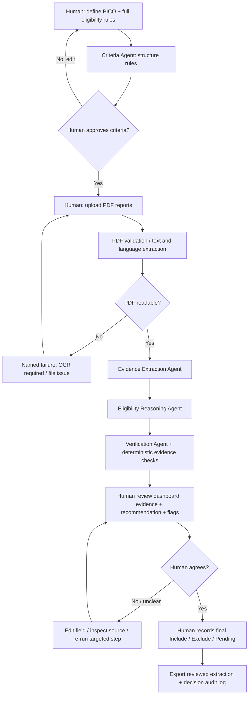
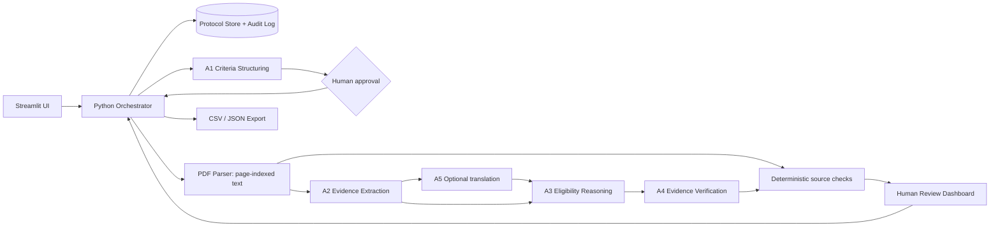

# MetaScreen-AI
## A Human-in-the-Loop Multi-Agent Framework for Evidence-Based Study Eligibility Screening and Data Extraction in Medical Systematic Reviews and Meta-Analyses

**Document type:** Midterm Project — Specification Document  
**Version:** 1.0 (implementation-oriented proposal)  
**Date:** 16 October 2026  
**Intended audience:** UST course instructor, medical researchers, lab members, and the subsequent Antigravity implementation agent  
**Project stage:** Specification / proposed prototype; **not** a validated system  
**Design principle:** *AI extracts and recommends; researchers verify and decide.*

> **Alignment with Week 5, Slide 5:** Sections 1–6 below follow the six required headings of **The Specification Document Template** exactly. The appendices translate the proposal into actionable implementation requirements and test cases. This project also implements the lecture's requirements for visible evidence, visible context, meaningful human oversight, and explicit failure states.

---

# 1. Problem Statement

## 1.1 Research context

Systematic reviews and meta-analyses in medicine typically begin with searches across multiple bibliographic sources, such as PubMed/MEDLINE, Embase, Web of Science, the Cochrane Library, CNKI, and Wanfang Data. Following searching, reviewers must screen potentially relevant records, inspect full-text reports, apply prespecified eligibility criteria, and extract study-level and outcome-level information. These stages are highly manual, repetitive, and vulnerable to inconsistent interpretation or transcription errors.

The difficulties intensify when reports are written in languages other than English (e.g., Chinese, Korean, Spanish, or French), present eligibility information across several sections or tables, or omit details needed for a confident decision. Full-text PDFs often contain heterogeneous layouts, scanned pages, supplementary tables, and different conventions for reporting sample sizes and outcomes.

## 1.2 The precise problem this app solves

**MetaScreen-AI assists with two related, but distinct, review activities:**

1. **Study eligibility assessment:** Extract evidence relevant to a reviewer-defined eligibility protocol and recommend whether a *study* appears eligible for the systematic review, requires clarification, or should be excluded under an explicit criterion.
2. **Structured data extraction with quality verification:** Extract study characteristics and selected quantitative results into a review-ready data table, flag inconsistent or unsupported fields, and let humans correct and approve every value.

A third enabling capability is **multilingual normalization**: translate relevant non-English content into English while retaining the source-language passage and its location for auditing.

**Important methodological distinction:** This project's “quality check” means **checking whether eligibility criteria are met and whether extracted data are adequately supported by the source**. It does **not** evaluate methodological quality or risk of bias using RoB 2, ROBINS-I, or GRADE. Those are separate, later activities and are **out of scope for the midterm MVP**.

## 1.3 Current versus desired workflow

| Dimension | Current workflow | Proposed supported workflow |
|---|---|---|
| Define study eligibility | Researchers repeatedly consult a protocol | Researchers enter PICO **plus explicit eligibility rules** once and approve their interpretation |
| Read articles | Manually navigate full texts and tables | Evidence Extraction Agent generates field-level facts with source quotations and PDF page references |
| Non-English articles | Translate passages manually or work through unfamiliar terminology | Translate decision-relevant excerpts to English, with original text retained |
| Decide eligibility | Manually compare every report with criteria | Eligibility Agent proposes a decision **per criterion** and highlights uncertainty |
| Check accuracy | Re-read the paper to locate each claim | Verification Agent checks groundedness and consistency; researchers click through to the original pages |
| Extract data | Copy statistics into spreadsheets | Generate structured, reviewable extraction tables with missingness flags |
| Document decisions | Maintain separate notes and spreadsheets | Save human decisions, primary exclusion reasons, source evidence, and an audit trail |

## 1.4 Research gap and motivation

A generic PDF chatbot may provide plausible summaries, but it does not reliably enforce a **predefined protocol**, distinguish a **report** from a **study**, provide **criterion-level evidence**, or maintain a **human-authorized audit trail**. MetaScreen-AI addresses these workflow and interface requirements through specialized agent roles, structured outputs, deterministic validation, and explicit approval gates.

The project's proposed contribution is primarily an **applied human–multi-agent workflow design**; the midterm prototype will **not** establish clinical validity, generalizability, or superiority over commercial systematic-review tools without a proper comparative evaluation.

## 1.5 Project objective

> **Build a working Streamlit prototype that accepts medical research PDFs and reviewer-approved eligibility criteria, extracts multilingual study information with verifiable evidence, proposes Include / Exclude / Needs Discussion decisions, and exports a human-approved extraction and decision log.**

## 1.6 Scope boundaries

**In scope for MVP**

- PDF upload (drag-and-drop), document parsing, and text-availability checks.
- User-configured PICO and additional inclusion/exclusion criteria.
- Full-text eligibility *recommendations* based on uploaded reports.
- Structured extraction of core study characteristics and a small, configurable subset of outcome data.
- Evidence citations (document, PDF page, original quotation) and extraction-verification flags.
- Human review, correction, decision override, and CSV/JSON export.
- Basic English normalization of relevant non-English passages when the selected model supports them.

**Out of scope for MVP**

- Automatically searching or downloading records from PubMed, Embase, CNKI, Wanfang, or other subscription databases.
- Fully automated title/abstract screening of database exports (future phase).
- Autonomous **final** exclusion or inclusion without human approval.
- Risk-of-bias assessment (RoB 2/ROBINS-I), GRADE, and statistical meta-analysis / forest plots.
- Automatic interpretation of inaccessible, corrupted, scanned, or image-only PDFs without a configured OCR tool.
- Guaranteed extraction of complex figures, image-only tables, or supplementary files.
- Validated support for all languages, disease domains, and study designs.

---

# 2. Target Users

## 2.1 Primary users

**Graduate students, medical researchers, and lab members** performing systematic reviews and meta-analyses. They are familiar with PICO, inclusion/exclusion rules, clinical terminology, and spreadsheet-based extraction, but may have limited software-engineering experience.

**Typical working environment:** university lab or hospital research office, laptop/desktop browser, a folder of full-text PDFs collected after literature searching, protocol documents, and Excel/CSV data-extraction forms.

## 2.2 Personas

| Persona | Background / need | Value provided | Decision authority |
|---|---|---|---|
| Lead reviewer / project owner | Defines the research question and eligibility protocol | Reusable project criteria, transparent screening recommendations, audit exports | Approves protocol and final study inclusion/exclusion |
| Second reviewer / labmate | Cross-checks full texts and extracted results | Evidence-linked review queue, discrepancy flags | Confirms or challenges decisions; resolves via discussion |
| Junior reviewer | New to medical meta-analysis | Guided PICO form, standardized extraction fields, clearly explained rules | May annotate or propose, but cannot silently finalize on behalf of lead reviewer |

## 2.3 Core user needs

- **Trust:** Every claimed fact must link back to a source passage.
- **Control:** Reviewers can edit eligibility criteria, correct extraction mistakes, and override AI recommendations.
- **Reproducibility:** Report which PDF, rules, model, prompt version, and human reviewer produced a decision.
- **Efficiency:** Spend more time resolving difficult cases and less time copying readily available facts.
- **Language accessibility:** Preserve the original non-English evidence, not merely a fluent English paraphrase.

## 2.4 Primary user story

> As a researcher conducting a medical systematic review, I want to upload full-text PDFs and specify my eligibility criteria so that a multi-agent assistant can extract relevant study details, cite the exact supporting passages, recommend eligibility dispositions, and let me verify and approve the results before export.

---

# 3. Core Features

## 3.1 Feature priority matrix (Slide 5 requirement)

| ID | Feature | Description / observable behavior | Priority | MVP acceptance criterion |
|---|---|---|---|---|
| F01 | **Upload & parse PDFs** | Drag-and-drop 1–10 PDFs, show file status, detected language, page count, extraction warnings | **Must-have** | Text-based PDFs are readable; unusable PDFs yield a named error, never an invented analysis |
| F02 | **Define & approve PICO + eligibility rules** | Enter P/I/C/O, study design, population thresholds, exclusions, publication/date/language restrictions if justified, and any other protocol rules | **Must-have** | Protocol is visible and explicitly confirmed before a screening run |
| F03 | **Extract structured evidence** | Extract bibliographic details, eligibility variables, study characteristics, and selected outcomes into structured records | **Must-have** | Critical extracted fields display source quotation + PDF page, or a clear “Not reported / Not found” status |
| F04 | **Verify evidence & recommend eligibility** | Check criterion-level evidence and recommend Include / Exclude / Needs Discussion, with reasons and contradictions | **Must-have** | A recommendation never becomes final without a human reviewer; disputed/unsupported cases are flagged |
| F05 | **Human review & export** | Review/correct fields, approve or override decisions, and export CSV/JSON plus a decision log | **Must-have** | Export distinguishes AI suggestion from final human decision and captures edit history |
| F06 | PDF-to-Markdown | Produce a page/section-preserving `.md` reading aid | Nice-to-have | Generated text is clearly labeled as converted content, not an authoritative transcription |
| F07 | Enhanced OCR / table extraction | OCR scanned PDFs, identify table structure and cell coordinates | Nice-to-have | Fail safely when unconfigured or low quality |
| F08 | Multi-reviewer blind screening + adjudication | Store two independent human decisions and reconcile disagreements | Phase 2 | No reviewer sees the other's decision before both submit (if enabled) |
| F09 | Duplicate / multiple-report linking | Identify possibly related reports by DOI, trial ID, title, authors | Phase 2 | Proposed links require human confirmation |
| F10 | PRISMA 2020 flow counts | Support defensible counts of records, reports, and studies | Phase 2 | Counts are calculated from explicit statuses rather than inferred from PDFs |

**MVP priority rule:** Features F01–F05 must work end-to-end before attempting F06–F10. For the midterm, three true LLM-based roles plus a deterministic controller are preferable to a large, fragile “swarm” of agents.

## 3.2 Eligibility protocol configuration — beyond PICO

**PICO alone is insufficient as executable eligibility logic.** The app must collect and save:

| Field | Example input (illustrative only; user-specific review protocol governs) |
|---|---|
| Review question | In adults with hypertension, does home blood-pressure telemonitoring improve blood pressure versus usual care? |
| Population (P) | Adults aged 18 years or older with hypertension |
| Intervention (I) | Home BP telemonitoring with data transmission to clinicians |
| Comparator (C) | Usual care without equivalent telemonitoring |
| Outcomes (O) | Systolic BP at follow-up; diastolic BP as secondary outcome |
| Eligible study design | Randomized controlled trials |
| Minimum follow-up | At least 4 weeks (only if justified in the protocol) |
| Exclusions | Pediatric-only populations; non-randomized studies; interventions not meeting the protocol definition |
| Other rules | Publication date, language, setting, study status, or minimum data requirements **only if prespecified and justified** |
| Operational ambiguity policy | If the full text does not establish an essential criterion, mark **Needs Discussion / Insufficient Evidence**, not Exclude by default |

**Protocol control:** The human approves a structured criteria preview. Any later edits create a new protocol version and flag prior recommendations as **stale / needs re-evaluation**. Criterion IDs (e.g., `P01`, `I01`, `D01`) must remain visible in decisions and exports.

## 3.3 Decision terminology and rules

The application must distinguish:

1. **AI recommendation** (`include`, `exclude`, `needs_discussion`) — advisory only.
2. **Final review decision** (`included`, `excluded`, `pending`) — explicitly recorded by a human.
3. **Eligibility for a particular quantitative synthesis** — a downstream, outcome-specific decision that is **not equivalent to inclusion in the systematic review**.

**Per-criterion evaluation:** `met`, `not_met`, `unclear`, or `not_applicable`, each with supporting evidence where available.

**Proposed recommendation algorithm (conservative and configurable):**

- If an **explicitly required criterion** is demonstrably not met based on sufficiently grounded evidence: propose **Exclude** and cite the relevant criterion and passage.
- Else if all essential criteria are supported and satisfied: propose **Include**.
- Else: propose **Needs Discussion** and say what is missing or contradictory.
- In **all** scenarios, human reviewers are the only actors who can confirm final exclusion or inclusion.

**Scientific caveat:** A study that meets review-level eligibility must **not** automatically be excluded merely because its measured outcome results cannot be extracted in a usable numerical form. Review inclusion and inclusion in a particular meta-analysis must remain separate. Missing numerical data should be flagged for clarification or later synthesis planning. See Cochrane MECIR standard C40 in References.

## 3.4 Minimum extraction data dictionary

The MVP uses configurable fields; it should not assume all papers report every variable.

| Category | Fields (baseline) | Special validation |
|---|---|---|
| Identification | `report_id`, `study_id` (nullable), title, authors, year, DOI, trial registration ID, source language | Preserve identifiers verbatim; do not infer a DOI |
| Study design | RCT / cohort / case-control / other; randomization evidence; parallel/crossover design if stated | “Randomized” requires a grounded source phrase; ambiguous classification is `unclear` |
| Population | Country/setting, condition, inclusion criteria, age information, participant counts | Distinguish enrolled/randomized/analyzed sample sizes |
| Intervention & comparator | Name, dose/intensity, frequency, duration, control details | Preserve arm-specific descriptions; do not collapse multi-arm trials |
| Outcomes | Outcome name, measurement instrument, time point, unit | Do not merge different time points or scales |
| Quantitative result (pilot: 1 selected outcome) | Per-arm `n`, continuous `mean`, `SD` **or** binary `events`, `total`; result type and time point | Avoid transforming SE/CI/median/IQR into SD unless an explicit approved rule is implemented |
| Provenance | Original quotation, PDF page, section/table identifier (if found), extraction method | Required for **every nontrivial reported value**; retain non-English original alongside translation |
| Extraction quality | `verified`, `needs_review`, `missing`, `conflicting`, `unsupported` | Labels describe validation state, **not** risk of bias |

**Missing data representation:** `null` + an explicit missingness code (e.g., `not_reported`, `not_found`, `not_applicable`, `parse_failed`). Never substitute zero for missing values. Never invent means, standard deviations, denominators, citations, or page references.

## 3.5 Multilingual requirements

- Detect the likely document language or ask the user to select it when detection is uncertain.
- Extract source-language quotations first; produce English normalization as an **additional** field, not a replacement.
- Keep numeric values, units, sample sizes, and negation intact; do not silently translate a negation or eligibility condition away.
- Display `Original (中文/한국어/español/français)` and `English translation` side by side with a page reference.
- Mark translation quality as `unverified_machine_translation` until checked; users may edit translated text while the original evidence remains immutable.
- When language coverage is weak or an extract is ambiguous, return **Needs Discussion** and recommend manual/bilingual reviewer verification.

## 3.6 Failure states that must be designed into the UI

| Failure / risk | Required behavior | User recovery action |
|---|---|---|
| Corrupted, encrypted, or image-only PDF | Visible `Parse Failed` / `OCR Required`; no eligibility judgment | Re-upload a searchable PDF or enable OCR |
| Context exceeds model budget | Show pages/chunks selected, approximate token usage, and anything omitted; do **not** silently truncate | Reprocess by section, select relevant pages, or choose supported model |
| No evidence for a decisive criterion | Mark criterion `unclear`; default recommendation **Needs Discussion** | Open PDF and provide manual evidence / amend rule |
| Contradictory data across text and tables | Mark `conflicting`; show both source locations | Human chooses correct value with a note |
| Incorrect or unsupported source quotation | Verification fails; do not show as verified | Retry targeted extraction / manual correction |
| Prompt-injection text embedded in PDF | Treat document content as **untrusted evidence**, never as instructions | Display a warning; continue under developer-controlled rules |
| Model timeout / API failure | Named failure and partial saved progress; no fabricated results | Retry failed step or switch configured provider |
| Uncertain language or translation | Mark `translation_needs_review` | Check original, request bilingual review |
| Suspected duplicate / secondary report | Flag potential study linkage; do not automatically count as independent study | Human confirms report-to-study relationship |
| Protocol changed after screening | Mark previous recommendations `stale` | Re-run with approved protocol version |

---

# 4. Human-AI Interaction Flow

## 4.1 End-to-end interaction steps

| Step | Actor | Trigger / action | Output | Human approval gate? |
|---|---|---|---|---|
| 1 | **Human** | Create a review project, enter PICO and eligibility rules | Draft protocol | **Yes — approve protocol** |
| 2 | **Human** | Upload PDF(s) | Uploaded report queue | No |
| 3 | **System / Intake tools** | Validate PDFs, count pages, extract text and identify potential language | Source text, metadata, warnings | No; fail visibly if unusable |
| 4 | **Criteria Agent** | Convert protocol into criterion IDs and a machine-readable rule set | Criteria preview with potential ambiguities | **Yes — accept/edit interpreted criteria** |
| 5 | **Evidence Extraction Agent** | Find PICO/study-design facts and selected outcome fields | Structured extraction + evidence spans | No; output remains provisional |
| 6 | **Eligibility Reasoning Agent** | Evaluate every approved criterion using extracted evidence | Include / Exclude / Needs Discussion *recommendation* | No finalization permitted |
| 7 | **Verification Agent + deterministic checks** | Check quote-to-page matches, number ranges, provenance, and contradictions | Verification report and uncertainty flags | No; failed checks require review |
| 8 | **Human reviewer** | Inspect evidence, correct values, discuss ambiguous cases, and select final disposition | Human-confirmed decision + reviewed extraction | **Yes — explicit confirmation** |
| 9 | **System** | Export selected, approved data | CSV, JSON, screening log and run metadata | User initiates export |

## 4.2 Flow diagram



## 4.3 UI layout (Streamlit MVP)

**Sidebar: Review Protocol**
- PICO inputs plus study design and user-defined inclusion/exclusion rules.
- `Validate protocol` → `Approve protocol` buttons; protocol version and editable criterion table.
- Selected LLM provider and a **visible model/context configuration** (without exposing API secrets).

**Tab 1: Upload & Processing**
- Multi-file drop zone, PDF list with page count, language, parse status, and failure details.
- `Run screening` button; explicit per-document stage status (Parsing → Extracting → Screening → Verifying → Ready for review).
- Input budget / omissions disclosure; if processing chunks, show exactly which pages were considered.

**Tab 2: Screening Dashboard**
- Table columns: Report, Study ID (if known), Language, AI Recommendation, Verification Flags, Human Decision, Review Status.
- Filter `Needs Discussion` / `Potential Exclude` / `Missing Evidence`.
- Click a report to inspect each criterion and its quoted source. An Exclude suggestion highlights the **exact violated rule**.

**Tab 3: Extraction Review**
- Editable extraction table with original source quote and page; English translations alongside original excerpts.
- Individual field controls: `Accept`, `Correct`, `Mark not reported`, `Re-extract`.
- For quantitative data, show arms, time points, units and denominator definitions separately.

**Tab 4: Decisions & Export**
- Explicit final decision buttons `Confirm Include`, `Confirm Exclude`, `Keep Pending`; require an exclusion reason for a final excluded full-text report.
- Export CSV/JSON and plain-text summary with reviewer, date/time, criterion, and protocol/prompt/model version.
- Show count summaries as **project records/reports**, not automatically as PRISMA study totals unless study-linking has been reviewed.

## 4.4 Human–AI decision boundary (“red zone”)

AI **may** parse, translate, extract, cross-check, suggest, highlight ambiguity, and generate drafts of exclusion reasons.

AI **must not**:

- Finalize study inclusion or exclusion.
- Quietly change PICO, eligibility thresholds, or review rules.
- Treat inability to extract data as proof a study is ineligible.
- Claim a study is high/low methodological quality based on the eligibility module.
- Invent quotations, page numbers, data values, or trial identifiers.
- Conflate two reports of the same study with two independent studies.
- Hide omitted pages or unsuccessful extraction stages.

The researcher retains intellectual responsibility for inclusion decisions and extraction accuracy. This is **human-in-the-loop decision support**, not autonomous evidence appraisal.

## 4.5 Illustrative user walkthrough (synthetic example)

**Approved protocol (example):** adult hypertension; clinician-linked home BP telemonitoring vs usual care; randomized controlled trials; minimum 4-week follow-up.

- **Report A:** Explicitly states randomized trial, adults with hypertension, telemonitoring vs usual care and 12-week follow-up. AI proposes **Include**, displays passages, and asks human for confirmation.
- **Report B:** Describes a retrospective observational cohort. AI proposes **Exclude** against criterion `D01: randomized trial required` and quotes the design text. Human verifies and confirms exclusion.
- **Report C:** Chinese-language report lists study arms but the extracted methods do not clearly establish random allocation. AI translates the relevant excerpt and proposes **Needs Discussion**, with `D01 = unclear`. Human reads the original page or seeks bilingual input before deciding.

These are **illustrative scenarios**, not real papers or observed model performance.

---

# 5. Technical Approach

## 5.1 Recommended midterm stack

| Layer | Proposed choice | Why / implementation note |
|---|---|---|
| Frontend | **Streamlit** (Python) | Fastest path to a runnable lab-facing prototype and clear human review interactions |
| Orchestration | Explicit Python state machine / coordinator | Deterministic sequence, traceability, and fewer moving parts than a full agent framework |
| LLM | Configurable **OpenAI / Gemini / Ollama** adapter | Use one model/provider initially; provider-agnostic interface; credentials from environment |
| PDF parser | **PyMuPDF** or `pypdf` with page-level provenance | PDF page mapping needed for citations; choose dependency with suitable license/deployment terms |
| Optional table helper | `pdfplumber` | Supports table-oriented extraction for select text-based PDFs |
| Optional OCR | Tesseract + OCR toolchain | Phase 2 fallback; show `OCR Required` in MVP if not configured |
| Structured validation | **Pydantic** | Enforce JSON schema and explicit missingness / enum values |
| Storage | **SQLite** + local project files (demo only) | Preserve approvals, versions, and audit log for prototype |
| Export | `pandas` CSV + Python JSON | Lab-friendly output formats |
| Config / testing | `python-dotenv`, `pytest` | Secrets management, reproducible unit/integration tests |

**Deployment constraint:** Antigravity is used as the **coding/development agent** to create this software. It is **not** assumed to be the application's runtime multi-agent engine. Runtime agents are implemented as discrete, testable Python components that may call an LLM.

**Data security:** Do not upload confidential/unlicensed PDFs to an external LLM without institutional permission and an approved data-processing arrangement. Local Ollama should be an option where data residency is required. Uploaded research reports may have copyrighted content; do not redistribute full text by default. This prototype is for research workflow support, not clinical decision-making.

## 5.2 Agent architecture and responsibility contracts

The architecture consists of an **orchestrator**, **three primary LLM agent roles**, **one optional language specialist**, and **deterministic validators**.

| Component | Input | Main responsibility | Required output | Can finalize eligibility? |
|---|---|---|---|---|
| **Orchestrator** (code, not an LLM agent) | Project protocol + PDFs | Controls sequence, retries, failures, cost/context budget, state transitions and logs | Stage states, run IDs, trace metadata | No |
| **A1 — Criteria Structuring Agent** | Human PICO + eligibility narrative | Parse criteria into explicit rule IDs, constraints, and ambiguities | `ProtocolCriteria` JSON, needing human sign-off | No |
| **A2 — Evidence Extraction Agent** | Page-numbered text chunks + approved criteria | Find key facts and results; extract original quotations and citations | `ExtractionRecord` JSON | No |
| **A3 — Eligibility Reasoning Agent** | Approved criteria + verified/flagged extraction | Evaluate criteria individually; produce conservative recommendation | `EligibilityAssessment` JSON | No |
| **A4 — Evidence Verification Agent** | PDF page text + extracted fields + assessment | Challenge unsupported claims, numbers, page matching, conflicting evidence and translations | `VerificationReport` JSON | No |
| **Optional A5 — Translation Agent** | Non-English evidence segments | Produce English translation aligned to original quoted evidence | Translation with original quote, language, and page | No |
| **Deterministic validators** | Agent JSON + parsed page text | Schema checks, exact/normalized quote matching, numeric constraints, required fields | Pass/fail flags | No |

**Implementation ordering:** A1 → human approval → A2 → A3 → A4 → human decision. A5 can be a dedicated sub-step before A3 when needed. A4 should independently inspect the source evidence instead of merely accepting A2's interpretation. Failures loop back to targeted extraction and/or human review; agent “votes” must never replace source grounding.

## 5.3 Architecture diagram



## 5.4 Evidence-grounding contract

Every decision-relevant fact must carry a traceable `evidence` object:

```json
{
  "report_id": "report_001",
  "field_name": "study_design",
  "value": "randomized controlled trial",
  "source_language": "en",
  "evidence": {
    "pdf_page": 3,
    "section": "Methods",
    "original_quote": "Participants were randomly assigned ...",
    "english_translation": null
  },
  "verification_status": "needs_review",
  "missingness_code": null
}
```

**Contract conditions:**

- `pdf_page` is **1-based PDF page indexing**, independent of printed journal page numbers; include printed page separately if available.
- `original_quote` must match a passage from the specified PDF page (allow only documented whitespace/unicode normalization); otherwise `verification_status = unsupported`.
- The example above is **schema illustration**, not a claim that a particular report contains the quoted passage.
- English translations are auxiliary; original quotations remain authoritative.
- Numerical values must preserve source units, groups, time points and statistic types.
- When extraction fails, use `null` and a reason instead of fabricated evidence.
- Every screening recommendation references the exact `criterion_id` and one or more evidence records; an ungrounded “confident” recommendation is prohibited.

## 5.5 Minimal structured models

Suggested schema names and fields:

```text
ReviewProject
  project_id, title, research_question, protocol_version, approved_by, approved_at

ProtocolCriteria
  criterion_id, category, operator, expected_value, description,
  required, inclusion_or_exclusion, ambiguity_note

Report
  report_id, file_hash, original_filename, language, page_count,
  parse_status, upload_time, possible_study_id

Study
  study_id, linked_report_ids[], trial_registration_id?, linking_status

ExtractedField
  report_id, field_name, value?, unit?, timepoint?, arm?,
  original_quote?, pdf_page?, english_translation?,
  missingness_code?, verification_status, extraction_agent_version

CriterionAssessment
  report_id, criterion_id, status, evidence_refs[], explanation

EligibilityAssessment
  report_id, recommendation, criterion_assessments[],
  recommended_primary_exclusion_reason?, unresolved_questions[]

HumanReview
  report_id, reviewer_id, final_decision, human_exclusion_reason?,
  field_corrections[], note, timestamp, protocol_version

RunAudit
  run_id, timestamp, model_provider, model_name, prompt_versions,
  protocol_version, parsed_pages, omitted_pages, warnings, errors
```

**Relational rule:** `Study` may have multiple `Report` objects. If not yet linked, use a provisional report-level decision and do not claim study-level uniqueness. The MVP can support manual study linking via a simple text field or leave links unresolved with a visible warning.

## 5.6 LLM prompts and safety controls

Each runtime agent should have its own versioned system instructions and a strict JSON response schema:

- **A1:** Extract criteria literally; surface ambiguous definitions; do not add new thresholds.
- **A2:** Extract only facts in provided pages; return original source evidence; missing means unknown, not zero.
- **A3:** Evaluate against **approved** criteria; return `needs_discussion` for unsupported crucial rules; distinguish review inclusion from quantitative synthesis.
- **A4:** Locate contradictions and page/quote mismatches; mark unsupported claims; do not rubber-stamp other agents.
- **A5:** Translate carefully without altering numeric values or inventing explanations; preserve source text.

**Untrusted-input boundary:** Uploaded PDF text is task data, never a system instruction. Prompts should delimit all source text. Ignore instruction-like passages embedded in papers (e.g., “ignore previous instructions”). UI should allow users to inspect relevant model/prompt version and input pages, subject to sensible security and length limits.

**Reproducibility:** Store provider/model identifiers, prompt/template versions, protocol version, temperature/configuration when supported, timestamps, PDF hashes, selected page IDs, and any omitted context. Exact deterministic model replay is **not guaranteed**; the trace enables investigation.

## 5.7 Proposed repository structure for Antigravity

```text
metascreen-ai/
├── app.py                         # Streamlit navigation and user actions
├── README.md                      # Setup, privacy warning, example workflow
├── requirements.txt
├── .env.example                   # Placeholder keys only, never real secrets
├── .gitignore
├── config/
│   └── defaults.py
├── agents/
│   ├── criteria_agent.py
│   ├── extraction_agent.py
│   ├── eligibility_agent.py
│   ├── verification_agent.py
│   └── translation_agent.py       # Optional
├── core/
│   ├── orchestrator.py
│   ├── models.py                   # Pydantic schemas/enums
│   ├── pdf_parser.py
│   ├── evidence_validator.py
│   ├── llm_client.py
│   ├── repository.py               # SQLite / local persistence
│   └── exports.py
├── prompts/
│   ├── criteria_v1.md
│   ├── extraction_v1.md
│   ├── eligibility_v1.md
│   └── verification_v1.md
├── tests/
│   ├── test_criteria.py
│   ├── test_evidence_validation.py
│   ├── test_decision_rules.py
│   ├── test_export.py
│   └── test_workflow.py
└── sample_data/
    └── README.md                  # Synthetic demo inputs or permitted test PDFs
```

## 5.8 Technical requirements and constraints

| ID | Nonfunctional requirement | Acceptance condition |
|---|---|---|
| NFR-01 | **Human authorization** | Every `final_decision` has a reviewer identity and timestamp; no LLM can populate final approval directly |
| NFR-02 | **Evidence traceability** | Every cited source maps to a report and PDF page; unsupported quote triggers an alert |
| NFR-03 | **Transparent incompleteness** | UI discloses unparsed pages, context omissions, API failures and translation uncertainty |
| NFR-04 | **Persistence** | Approvals and corrections survive browser refresh/app restart in the local demo deployment |
| NFR-05 | **Interoperability** | Users can export flat CSV and structured JSON; nulls stay null |
| NFR-06 | **Basic security** | Enforce PDF file type/size limits, sanitize filenames, store secrets in environment, avoid logging API keys or full sensitive content |
| NFR-07 | **Cost control** | Show per-run estimated token usage or a transparent proxy; process one report at a time and cache successful stages |
| NFR-08 | **Failure recovery** | Parser/LLM error leaves a legible report status and supports targeted retry without losing human edits |
| NFR-09 | **Review integrity** | Changing approved criteria invalidates previous AI assessments until re-run |

**Initial capacity assumption for demo (adjustable):** 1–10 text-based PDFs per review, up to ~30 MB per PDF, with a user-visible page/token budget. These are engineering assumptions, not evidence about model performance.

---

# 6. Success Criteria

## 6.1 Definition of a successful midterm deliverable

MetaScreen-AI succeeds as a **midterm prototype** if a reviewer can run the app locally, upload several PDFs, approve an eligibility protocol, inspect evidence-based recommendations, correct extracted data, record final human decisions, and export a usable review table **without treating an LLM answer as final authority**.

## 6.2 Evaluation metrics and proposed targets

All numerical targets below are **proposed acceptance goals**, **not experimentally demonstrated results**. A small midterm test cannot establish clinical-grade generalization.

| Metric | Definition / measurement | Proposed midterm target |
|---|---|---|
| End-to-end functionality | Working demo for valid text-based PDFs | At least **3 different test reports** complete the full flow |
| Decision safety | Number of AI-only finalized include/exclude decisions | **0** |
| Evidence traceability | Fraction of non-missing *critical eligibility fields* with a valid PDF-page evidence link | **≥ 95%** in the demo test set; ungrounded fields clearly flagged |
| Validated eligibility agreement | AI recommendations matching a human-adjudicated reference across eligible/excluded/unclear cases | Report the observed confusion matrix; **aim ≥ 85%** on pilot set, not a deployment guarantee |
| Eligible-study sensitivity | `TP / (TP + FN)` for truly eligible studies, where `FN` is a definitive AI *Exclude* recommendation | **Target ≥ 95%** in a later larger test; for a small demo prioritize **zero unsafe definitive exclusions** and report case counts |
| Quantitative extraction accuracy | Exact matches to human-checked critical numerical values (arm, n, mean/SD or events/total, time point, unit) | **Aim ≥ 90%** on a small annotated pilot, report denominator and error types |
| Multilingual robustness | English normalization paired with original quote and page | Demonstrate **at least 1 non-English PDF**, if available and extractable; label uncertain translations |
| Time efficiency | `(manual time − assisted time) / manual time`, measured on matched tasks including human verification | **Explore ≥ 30% reduction** as a hypothesis; report actual observed time without implying proof |
| Audit completeness | Final human decisions with reviewer ID, reason where required, timestamp and protocol version | **100%** |
| Failure transparency | Tested error states show actionable explanations | **100% of predefined high-priority failure tests** display a named state |

**Priority of metrics:** Minimizing incorrect definitive exclusions and preserving evidence traceability takes precedence over speed or the volume of papers processed.

## 6.3 Pilot evaluation protocol

1. **Test corpus:** Curate ~10–20 legitimately accessible full-text PDFs where feasible; include several clearly eligible, clearly excluded, and genuinely unclear cases. Add 1–3 non-English PDFs if rights and language expertise permit. Use synthetic fixture PDFs for software edge cases.
2. **Reference standard:** Two qualified reviewers independently classify papers using a pre-approved protocol and adjudicate discrepancies; where two reviewers are unavailable, acknowledge the weaker single-reviewer reference and do not claim clinical validation.
3. **Ground-truth extraction:** Annotate critical PICO/design fields and a small set of numerical results, including report/page anchors.
4. **Run protocol:** Fix criteria and model version before testing; preserve all outputs. Do not silently remove difficult or failed PDFs from the denominator.
5. **Metrics:** Report recommendations by class, false definitive exclusions, missingness, grounded citation validity, extraction errors, and end-to-end review time including manual corrections.
6. **Error analysis:** Classify PDF parsing errors, mistranslations, incorrect population/study design interpretation, cross-page omissions, table extraction errors, hallucinated evidence and duplicate-report confusion.
7. **Reporting:** Distinguish a successful workflow demonstration from research-grade validation. Describe any model and automation support used in study selection/extraction in future systematic review methods sections.

## 6.4 Five concrete acceptance tests

| Test | Input | Expected result |
|---|---|---|
| AT-01 — Clearly eligible | Searchable PDF meeting every approved criterion | AI suggests Include with evidence; human must confirm |
| AT-02 — Clearly ineligible | PDF explicitly reporting an excluded study design | AI suggests Exclude with exact criterion + quote; human must confirm and record reason |
| AT-03 — Crucial detail unclear | Design/age criterion absent or ambiguous | Needs Discussion, unresolved question, **no invented exclusion** |
| AT-04 — Unsupported extraction | Agent returns wrong/nonexistent quote or wrong page | Verification flags unsupported evidence; user can correct or re-run |
| AT-05 — Unusable input | Image-only or encrypted PDF with no usable text | Named Parse Failed/OCR Required state, **no eligibility recommendation** |

## 6.5 Midterm deliverables and demo script

The lecture specifies three outputs: **(1) Specification Document, (2) Working Prototype, and (3) a 3–5 minute prerecorded video pitch**. The supplied Week 5 lecture specifies a **Friday, 23 October** submission deadline (24:00) and Week 8 review session; students should check the course's official submission instructions before submission.

**Suggested 3–5 minute video:**

- **0:00–0:40:** Clinical review bottleneck and separation of eligibility versus RoB 2.
- **0:40–1:15:** PICO + other rules entered and explicitly approved.
- **1:15–2:15:** Upload 2–3 PDFs, show multi-agent stages and Include/Exclude/Needs Discussion recommendations.
- **2:15–3:10:** Click an evidence quote/page, correct a field, and record a human decision.
- **3:10–3:45:** Demonstrate an error/failure state and a multilingual evidence pair (if available).
- **3:45–4:30:** Export CSV/JSON, explain auditability and scope limitations.

## 6.6 Anticipated outcomes (hypotheses, not claims)

- Less repetitive manual extraction and fewer transcription inconsistencies.
- Faster identification of records requiring human judgment.
- Improved transparency of why a given article was proposed for inclusion/exclusion.
- More practical consideration of non-English evidence without erasing original text.
- A reproducible agent-based workflow suitable for refinement into a larger research evaluation.

---

# Appendix A — Implementation Plan for Antigravity (Next-Step Handoff)

**This appendix describes what the implementation agent should build; it is not evidence that the software already exists.**

## A.1 Phase-by-phase build order

| Phase | Development task | Deliverable | Definition of done |
|---|---|---|---|
| **P0 — Skeleton** | Initialize Streamlit project, `.env.example`, local DB, schema, provider adapter | App runs with placeholder project and tabs | `streamlit run app.py` opens without exceptions |
| **P1 — Protocol + upload** | PICO form, custom criteria, human approval, PDF upload and page-numbered parsing | Approved criteria + parsed report status | Valid and invalid PDFs handled explicitly |
| **P2 — Extraction agent** | Implement structured prompts, source-aligned extraction and JSON validation | Evidence table and statuses | Missing fields return null/status; page anchors visible |
| **P3 — Screening + verification agents** | Criterion checks, suggestion policy, source quote check, discrepancy flags | Advisory decision dashboard | No fabricated final decisions; unclear scenarios handled |
| **P4 — Human review + export** | Editable values, final decision gate, persistent audit, CSV/JSON exports | Working end-to-end MVP | Acceptance tests AT-01 through AT-05 pass |
| **P5 — Demo hardening** | Test fixtures, failure UI, context metadata, README, sample walkthrough | Midterm-ready app and reproducible demo | New lab member can follow README and run the example |
| **Stretch** | Markdown conversion, OCR, improved tables, linking multiple reports, second reviewer | Separate optional improvements | Must not block completed MVP |

## A.2 Agent acceptance contract

Antigravity should implement each agent as a **separate callable module** with typed inputs and outputs; all outputs must undergo schema validation. **No agent should write directly to `HumanReview.final_decision`.** The coordinator, not the LLM, controls state changes and persistence.

**Minimum API shapes (illustrative):**

```python
structure_criteria(user_protocol: dict) -> ProtocolCriteria
extract_evidence(report_pages: list, approved_protocol: dict) -> ExtractionRecord
assess_eligibility(extraction: dict, approved_protocol: dict) -> EligibilityAssessment
verify_evidence(report_pages: list, extraction: dict, assessment: dict) -> VerificationReport
save_human_decision(report_id: str, reviewer_id: str, decision: str, reason: str | None) -> None
export_project(project_id: str, format: str) -> bytes
```

Do not import these signatures verbatim without defining the Pydantic models and storage interfaces. Exact shapes can be adjusted while preserving the contracts.

## A.3 Strict MVP exclusions for time management

Antigravity should **not** attempt cross-database article search, RoB 2 assessment, effect-size calculation, automatic statistical pooling, a generalized multi-reviewer auth system, or fully automatic OCR unless the complete must-have workflow already works reliably.

## A.4 Definition of Done for the coding agent

- [ ] End-to-end Streamlit application runs locally using instructions in `README.md`.
- [ ] At least three specialized agents (extraction, eligibility, verification) are actually invoked as separate modules or distinct model calls; no fake agent labels.
- [ ] A project-level human-approved criteria schema exists and is versioned.
- [ ] A parser failure produces no speculative eligibility output.
- [ ] An LLM JSON-schema failure is handled without crashing the whole app.
- [ ] Each major eligibility claim shows report ID, PDF page and original quotation or is clearly labeled unsupported.
- [ ] Include/Exclude is a **recommendation**, never a silently finalized decision.
- [ ] `Needs Discussion` is a first-class outcome.
- [ ] Humans can change extracted fields and record explicit final decisions with exclusion reasons.
- [ ] Export includes extracted data, AI suggestion, human final decision and a traceable audit entry.
- [ ] Automated tests cover at least the five acceptance scenarios and basic input/provenance validators.
- [ ] Repository contains no hard-coded API keys, copyrighted article test files without authorization, or real sensitive data.

---

# Appendix B — Proposed Scholarly Framing and Future Research Extension

The future research question can be stated as:

> **Can an evidence-grounded, human-in-the-loop multi-agent system reduce the time required for full-text eligibility screening and structured data extraction while preserving eligible-study sensitivity, extraction accuracy, and decision auditability across English and non-English medical research reports?**

**Research design after the midterm:** Controlled user study or paired-workflow comparison of manual screening/extraction versus MetaScreen-AI-assisted screening/extraction. Evaluate time, false exclusion rates, inter-reviewer disagreement, error severity, multilingual subgroup performance, and user trust/calibration. For a later scholarly contribution, compare the system against an appropriate single-agent baseline **and** a manual-only baseline rather than assuming multi-agent design is inherently superior.

**Potential ablation experiments:** With/without independent Verification Agent; with/without original-language evidence; PICO-only versus full protocol criteria; paragraph-only versus page-grounded extraction. Such experiments may support a stronger publication contribution if performed on sufficiently broad, independently adjudicated datasets.

**Methodological caution:** PRISMA 2020 is a **reporting guideline**, not proof that software outputs are correct or that a review is methodologically sound. Any eventual real systematic review must follow its own registered protocol, inclusion criteria, reviewer procedures, and suitable guidance for its study type.

---

# Appendix C — References and Source Alignment

## Course materials

- **UST Lecture, Week 5 — “Human–AI Agent Interaction Design”**, supplied HTML slides. **Slide 5** defines the six-section specification template. Slides **4, 6–8, 12, 35–39** additionally motivate specific problem statements, human/AI approval gates, visible context/evidence, error design, and the midterm deliverables. This specification follows the lecture's structure and extends it with implementation details.

## External methodological standards and guidance

1. **PRISMA 2020 statement and checklist** — Items **5** (eligibility criteria), **8** (selection process), **9** (data collection), **10a/10b** (data items), and **11** (risk of bias, a distinct step):  
   https://www.prisma-statement.org/prisma-2020  
   https://www.prisma-statement.org/prisma-2020-checklist
2. **PRISMA 2020 explanation and elaboration**, particularly requirements to describe automation and article translation when used:  
   https://www.bmj.com/content/372/bmj.n160
3. **Cochrane Handbook, Chapter 4 — Searching for and selecting studies**, including the distinction between *studies* and *reports*, and checking multiple reports for one trial:  
   https://www.cochrane.org/authors/handbooks-and-manuals/handbook/current/chapter-04
4. **Cochrane MECIR — Selecting studies (C39–C42)**, especially **C40** on not excluding otherwise eligible studies solely because usable outcome data are unavailable:  
   https://www.cochrane.org/authors/handbooks-and-manuals/mecir-manual/standards-conduct-new-cochrane-intervention-reviews-c1-c75/performing-review-c24-c75/selecting-studies-include-review-c39-c42
5. **PRISMA 2020 flow diagram guidance**, distinguishing records, reports and studies:  
   https://www.prisma-statement.org/prisma-2020-flow-diagram

---

**End of Specification Document — Version 1.0**
