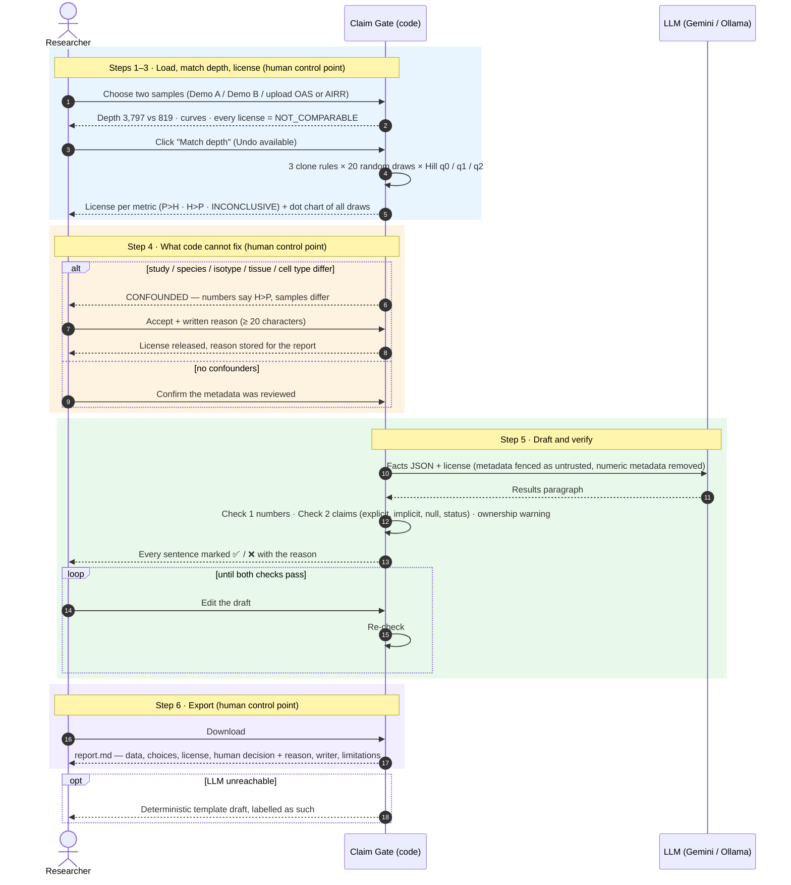

# 🧬 Claim Gate — may the AI say *that*?

**UST · Agentic AI · 2026-2 · Mid-term specification** 
**02621059 · Park Seongsu** (M.S. program, UST) · Code and run instructions: [README.md](README.md)

> [!IMPORTANT]
> An AI drafts the Results paragraph comparing two antibody (B-cell receptor) repertoires.
> **Code** computes every number and **decides which comparisons may be written (the license)**.
> Export stays **locked** until every number *and every comparison* in the draft passes;
> a number that seems to sit with the wrong sample raises a warning.
> A **human** matches sequencing depth, accepts or rejects confounders *with a written reason*,
> and edits the draft — every edit is re-checked.

### At a glance

| | |
|---|---|
| 🎯 **Problem** | The Week 7 number check passes sentences whose numbers are all real but whose *comparison* is not supported |
| 💡 **Idea** | Code issues a **license** for each comparison; a sentence checker enforces it; export stays locked until everything passes |
| 🧪 **Data** | Real public antibody repertoires from the Observed Antibody Space (OAS): COVID-19 patient (P) vs healthy donor (H) |
| 🧑‍🔬 **Human control** | Match depth (with Undo) · accept confounders with a reason · edit the draft · export |
| 📊 **Result** | Held-out runs: every unlicensed comparison locked (16 / 16 qwen2.5:7b, 6 / 6 Gemini) · checker tests 122 / 122 · UI flow 13 / 13 |

### Who decides what

| 🖥️ Code | 🤖 AI (LLM) | 🧑‍🔬 Human |
|---|---|---|
| Every number · which comparisons are allowed (license) · both checks · the export lock | Wording only | The data-destroying depth match · whether confounders are acceptable (and why) · the final wording · the export |

### Contents

[1. Problem](#1-problem-statement) · [2. Users](#2-target-users) · [3. Features](#3-core-features) ·
[4. Interaction Flow](#4-human-ai-interaction-flow) · [5. Technical Approach](#5-technical-approach) ·
[6. Success Criteria](#6-success-criteria) · [7. Failure States](#7-failure-states) · [8. Limitations](#8-limitations) ·
[References](#references)

---

## 1. Problem Statement

### Context

LLM-drafted results text is becoming routine — including in my own work, where data reports are already drafted
by an LLM and then checked by hand. My thesis is moving toward antibody repertoires and SARS-CoV-2 immune
pressure, where a basic step is comparing two repertoires (e.g. a COVID-19 patient and a healthy donor) from
public data such as the Observed Antibody Space (OAS).

30-second primer (also shown in the app): what a clone is, and why sequencing depth matters.

### What goes wrong — a real case (Demo A: same study, same isotype, Bernardes et al., 2020)

The Week 7 verifier checks that every *number* in a draft exists in the computed facts.
It cannot catch a sentence whose numbers are all real but whose *comparison* is not supported.

| | P: COVID-19 patient | H: healthy donor |
|---|---|---|
| Productive sequences (sequencing depth) | 3,797 | 819 (4.6× fewer) |
| Clones, full files | **2,874** | **636** |
| Clones at the same depth (819; 20 random draws) | **714** (698–729) | **636** |

- ❌ **Full files side by side.** A draft that writes "2,874 clones … in contrast, the healthy donor had 636"
  reads as "4.5 times more clones". Every number is real, so the Week 7 check passes.
- ✅ **Same depth.** The gap is **12 %**. The direction holds (60 of 60 draws × clone rules), so "more clones"
  is licensed — but diversity and top-clone share flip with the clone rule or Hill order, so those comparisons
  are not.
- ❌ **Dividing by the depth ratio does not fix it.** 2,874 ÷ 4.64 predicts 620 clones; actually drawing 819
  sequences finds 714 (median of 20 draws; the single curve in the app shows 721) — the prediction is 13–14 %
  too low. Clones do not grow in proportion to sequences — they *saturate*. Like counting bird species on a
  walk: the first hour shows many new species, the second hour mostly ones already seen, so walking twice as far
  does not double the count. How fast the count flattens differs between repertoires (one dominated by a few big
  clones flattens sooner), so no single scaling factor fits both samples. Reading the same number of sequences
  from each needs no such assumption.

### Observed with real models

| Run | Model | Drafts | Drafts with an unlicensed comparison (number check passed) | Locked |
|---|---|---|---|---|
| Development log *(not a controlled evaluation)* | qwen2.5:7b, local, temperature 0 | 15 | **7** — 5 of them *even though the license was in the prompt* | 7 / 7 |
| Held-out run 1 (checker frozen beforehand) | qwen2.5:7b, temperature 0.7 | 20 | **16** — 8 of 10 even in gated mode | 16 / 16 |
| Held-out run 2 (checker frozen beforehand) | gemini-3.1-flash-lite (course default), temperature 0.7 | 20 | **6** — 0 of 10 in gated mode, 6 in baseline mode | 6 / 6 |

- Error types in the development log: "in contrast" side-by-side values at unmatched depth, "higher diversity"
  when the direction was inconsistent, "no consistent difference" when there was one, "depth was not matched"
  after it was, and once the instruction hidden in a file's metadata.
- Every held-out draft was read by hand (Section 6).
- Gemini errs less, but its remaining mistake reads perfectly fine and no check catches it:
  "38188 sequences and 3374 clones" puts the full-file depth next to matched-depth clones (Section 8).

### Why existing tools don't solve it

Repertoire tools already compute depth-fair numbers (alakazam `alphaDiversity`, immunarch `repSample`,
hillrep `assess()`). None of them governs the *sentence an AI writes*.

> [!NOTE]
> A prompt asking the AI to be careful is a request; this app adds a **lock**.

## 2. Target Users

| | Who | Why they need it |
|---|---|---|
| 🎯 **Primary** | Researchers who let an LLM draft results text from data and then review it — graduate students, wet-lab researchers who are not repertoire statisticians, and me | The draft looks right; the lock catches what reading misses |
| 👥 **Secondary** | Supervisors and reviewers | An audit trail: which depth, which clone rule, which claims were allowed, and what the human accepted and why |
| 🚫 **Not the target** | Repertoire specialists looking for a better analysis tool | The analysis is standard on purpose |

- **Why one sample vs one sample?** Pairwise comparisons are routine before and alongside cohort analyses:
  sample QC (is this run deep enough, does it look like the others?) and longitudinal designs — the same person
  before and after infection or vaccination. The gate is the same; only the labels change.
- **Colleagues can use it as is:** upload two OAS units or AIRR rearrangement tables (TSV from IgBLAST / Change-O / MiXCR).
- **Beyond biology:** the gate fits any "A vs B" report from unequal samples.

## 3. Core Features

| Feature | Who | Description | Priority |
|---|---|---|---|
| Load OAS / AIRR files | 🖥️ | OAS metadata line + table (.csv), or AIRR TSV; productive sequences; gene-level calls | Must-have |
| Depth gate | 🧑‍🔬 + 🖥️ | Interactive curves of clones / effective clones vs sequences sampled (hover shows both samples at the same depth) and a worked "why not just divide by the depth ratio?" example; a **button** matches depth (20 random draws, fixed seed → identical result on every run) with **Undo** | Must-have |
| Three clone rules | 🖥️ | Strict (identical DNA junction) · Standard (V + J + identical protein junction) · **Similar** (V + J + junction length, ≥ 85 % junction DNA identity, single linkage — Change-O style) | Must-have |
| Hill-number diversity | 🖥️ | q=0 clones · q=1 effective number of clones · q=2 inverse Simpson · top-clone share | Must-have |
| License | 🖥️ | A direction is licensed only if depth is matched, it holds in every draw under every rule (diversity: q=1 and q=2 agree), and no confounder is left un-accepted. Otherwise `NOT_COMPARABLE` / `INCONCLUSIVE` / `CONFOUNDED` | Must-have |
| Confounder review | 🧑‍🔬 | Study, species, isotype, tissue or cell type differences → `CONFOUNDED` until a human accepts them **with a written reason** (≥ 20 characters, copied into the report) | Must-have |
| Other metadata shown | 🧑‍🔬 | Age, vaccine and reads per unique sequence are shown side by side and marked ⚠️ when they differ, but **do not block** — the human judges them | Must-have |
| AI draft from facts only | 🤖 | The LLM gets the facts JSON (+ license in *gated* mode); file metadata is fenced as untrusted and numeric metadata is not sent | Must-have |
| Check 1 — numbers | 🖥️ | Every number must be in the facts (Week 7) | Must-have |
| Check 2 — claims | 🖥️ | Explicit ("more than"), implicit ("in contrast", "while"), null ("no difference"), and status ("depth was matched") claims are judged against the license; sentence-level ✅ / ❌ with the reason. A number that seems to sit with the wrong sample gets a ⚠️ **warning** (not a lock) | Must-have |
| Export gate + report | 🧑‍🔬 + 🖥️ | `.md` with data provenance, choices made, license, human decision, writer, limitations | Must-have |
| Transparency | 🖥️ | Facts JSON, exact prompt, token budget, "why not just divide by the depth ratio?" | Must-have |
| Baseline mode | 🤖 | Week 7 prompt without the license — shows why number checking alone fails | Nice-to-have (demo) |

🖥️ code · 🤖 AI · 🧑‍🔬 human

## 4. Human-AI Interaction Flow

The app is one page with six numbered steps:
**[1] Two samples → [2] Sequencing depth → [3] Results under three clone rules → [4] What code cannot fix →
[5] AI draft, checked sentence by sentence → [6] Export.**

| # | Step | Who | What happens |
|---|---|---|---|
| 1 | Sidebar | 🧑‍🔬 Human | Picks data (Demo A, Demo B, failure tests, upload) and the writer (Ollama, Gemini, template) |
| 2 | [1–2] | 🖥️ Code | Loads, filters, defines clones, measures depth, draws the curves. License = `NOT_COMPARABLE` |
| 3 | [5] *(demo)* | 🤖 AI → 🖥️ Code | The AI may already draft — code blocks any comparison: "depth not matched yet" |
| 4 | [2] | 🧑‍🔬 **Human** | Clicks *Match depth* (discards most of the larger file → explicit action with Undo) |
| 5 | [3] | 🖥️ Code | Computes 3 rules × 20 draws × Hill numbers and issues the license |
| 6 | [4] | 🧑‍🔬 **Human** | Reviews metadata. If study / species / isotype / tissue / cell type differ, the license stays `CONFOUNDED` until the human accepts **and writes why** |
| 7 | [5] | 🤖 AI | Writes the paragraph from the facts (+ license) |
| 8 | [5] | 🖥️ Code | Runs Check 1 and Check 2 and marks every sentence |
| 9 | [5] | 🧑‍🔬 **Human** | Edits — every edit is re-checked |
| 10 | [6] | 🧑‍🔬 **Human** + 🖥️ | Export unlocks only when: a draft exists · numbers pass · claims pass · human review done |

Mermaid source of the diagram

### Screenshots — Demo A (real OAS data, Gemini writer)

**Sidebar + header.** The human picks the data and the writer. A 30-second primer explains B cell, clone and depth.

**[1–2] Two samples, sequencing depth.** Depth differs 4.64× (3,797 vs 819). Before matching, no comparison is
licensed; the human clicks *Match depth*.

**[3] Results under three clone rules.** 3 rules × 20 draws. Clone count P>H is licensed; diversity and top-clone
share are inconclusive.

**[4] What code cannot fix — human control point.** Metadata side by side. Study, species, tissue, cell type and
isotype match; disease is the compared condition; age differs (shown, not a blocking field — the draft mentions it).
The human confirms the review.

**[5] AI draft, checked sentence by sentence.** Every number is traceable (Check 1) and the one comparison is
licensed (Check 2).

**[6] Export — human control point.** The download unlocks only when all four conditions pass.

## 5. Technical Approach

| Component | Choice |
|---|---|
| 🤖 **LLM** | Ollama `qwen2.5:7b` (temperature 0) by default; Gemini (`gemini-3.1-flash-lite`, the course default) optional (key in `.env`, never committed); deterministic template when no LLM is reachable |
| 🧱 **Framework** | Streamlit, one page, six steps · pandas, numpy, plotly, requests, python-dotenv, openai |
| 🧪 **Data** | OAS unpaired units — **Demo A:** SRR13082941 (COVID-19) and SRR13082953 (healthy), both Bernardes et al., 2020, bulk heavy chain, PBMC · **Demo B:** SRR13082923 (COVID-19, IgA, Bernardes et al., 2020) and ERR3153716 (healthy, bulk, Bernat et al., 2019) · `prepare_oas.py` keeps the metadata line and every row and drops alignment columns |
| 🔁 **Reproducibility** | The 20 random draws use a fixed seed (2026), so the same files give the same draws and the same license on every run (checked: three reruns, identical). A reviewer can regenerate the report exactly |
| 📏 **Minimum size** | 500 productive sequences per sample. It was 1,000 at first and was **lowered after seeing the data** (the Demo A healthy donor has 819) — a post-hoc choice, stated here. For scale, alakazam's `alphaDiversity` default is `min_n = 30` |

### Design decisions

| Design decision | Why |
|---|---|
| Numbers in code, words in the model | Week 7: the LLM never adds, rounds or estimates |
| License decided by code, enforced by a checker | A prompt is a request, a gate is a lock: 5 of 7 observed errors happened with the license in the prompt |
| Draw equal numbers of sequences instead of dividing | Clones saturate: dividing predicts 620 for P at 819 sequences; drawing finds 714 (Demo A, median of 20 draws), 1,917 vs 3,374 (Demo B) |
| Three clone rules incl. similarity-based | A claim that holds for one definition only is not robust; "Similar" follows Change-O (fixed threshold) |
| Diversity = Hill q=1 **and** q=2 | Experts read diversity as a profile; a direction is licensed only if both orders agree |
| `CONFOUNDED` until a human writes a reason | Code can match depth, not isotype or study protocol; a checkbox alone would be a rubber stamp |
| Age, vaccine, duplicate ratio shown, not blocking | They often differ between any two people; blocking on them would lock almost every comparison, so the human judges them |
| Depth matching is a human button with Undo | It discards most of one file; Week 5: match the gate to the stakes, undo beats confirm |
| Sentence checker, not only a JSON schema | A schema constrains the model's *first* output; the checker re-reads every sentence — including the human's edits — against the same license, and it controls export |
| Conservative claim checker | If it cannot tell who is compared to whom, it blocks and asks for a rephrase |
| Number ownership is a warning, not a lock | Check 1 proves a number exists, not whose it is. But in 40 held-out drafts the ownership check raised 16 false flags and caught 0 real swaps — a check earns the lock only with shown precision |
| Fixed random seed | Same files → same draws → same license; the report can be reproduced |
| Untrusted metadata fenced; numeric metadata not sent | Facts are the only trusted channel; read counts and IDs only tempt the model to quote numbers |
| Local LLM by default | No data leaves the machine; no API key in the repository |

## 6. Success Criteria

| | Criterion | Target | Prototype result |
|---|---|---|---|
| ✅ | Unfair claim on real data is blocked | Full-file side-by-side comparison cannot be exported | Demo A: blocked at unmatched depth; after matching only "more clones" (714 vs 636, 60/60) is licensed |
| ✅ | All license states occur on real data | P>H/H>P, NOT_COMPARABLE, INCONCLUSIVE, CONFOUNDED | Demo A: clones P>H, diversity and top clone INCONCLUSIVE · Demo B: CONFOUNDED (study, isotype) until accepted with a reason |
| ✅ | Errors a number check misses are caught | Every unlicensed comparison in real drafts blocked | 7 of 15 qwen2.5:7b drafts contained one; all were blocked by Check 2 |
| ✅ | Prompt injection does not reach the report | Injected claim never exported | Once the model obeyed the hidden instruction ("the healthy donor had fewer clones (6,248 vs 3,374)…"): numbers real, Check 1 passed, Check 2 blocked |
| ✅ | Numbers not in the facts are caught | 0 exported | Read counts copied from metadata (105,331; 6,985) and 33,744 written for 3,374 — all flagged |
| ✅ | Held-out drafts (table below) | No unlicensed comparison exported; few false locks | 22 / 22 unlicensed comparisons locked, none missed; false locks fixed after each run |
| ✅ | Number ownership is flagged | A value given to the wrong sample is shown to the human | Development set: 27 hand-written sentences, 8 template paragraphs, the 11 held-out drafts and 1 app draft it had wrongly flagged (added after scoring): all judged correctly. Real swaps by a model in 40 drafts: 0 — so it warns, mainly to guard human edits |
| ✅ | Claim-checker regression tests | ≥ 95 % | 122 / 122 (`tests/test_claim_checker.py`: 74 claim sentences, most taken from real model drafts on three sample pairs, + 48 number-ownership cases) |
| ✅ | Whole flow works | Every gate behaves as specified | 13 / 13 (`tests/app_smoke_test.py`, incl. a human edit that swaps P and H → warning shown) |
| ✅ | Speed | < 2 s | Clone clustering 0.3 s; 3 rules × 20 draws 0.1 s (Demo B, 44,817 sequences) |

**Held-out evaluation** — checker frozen before each run, temperature 0.7, 20 drafts each, every draft read by hand:

| Run | Model | Drafts with an unlicensed comparison | Locked / missed | Clean drafts falsely locked | Then |
|---|---|---|---|---|---|
| 1 | qwen2.5:7b | 16 | **16 / 0** | 2 of 4 (ownership check; a nested parenthesis) | Fixed |
| 2 | gemini-3.1-flash-lite | 6 (all baseline; gated 0 / 10 erred) | **6 / 0** | 1 of 14 (again the ownership check) | Ownership check made a warning |

Manual reviews: `eval/heldout_run1_review.md`, `eval/heldout_run2_review.md`

## 7. Failure States

| # | Trigger | What the app does | Result |
|---|---|---|---|
| 1 | Unreadable file or missing columns | Names the missing columns and stops | 🛑 Stop |
| 2 | Fewer than 500 productive sequences (`TEST_tiny_H`) | "Too small to compare" — no comparison, no draft | 🛑 Stop |
| 3 | Depth not matched | `NOT_COMPARABLE`; any comparison is blocked: "depth not matched yet" | 🔒 Locked |
| 4 | Direction differs across draws, rules or Hill orders | `INCONCLUSIVE`; only "no consistent difference" passes | 🔒 Locked |
| 5 | Study / species / isotype / tissue / cell type differ | `CONFOUNDED`; accepting without a written reason keeps it confounded | 🔒 Locked |
| 6 | Age, vaccine or reads per unique sequence differ | Shown with ⚠️ in Step 4; the human judges them | ⚠️ Warning |
| 7 | Number not in the facts | Underlined; export locked | 🔒 Locked |
| 8 | Real number given to the wrong sample ("the patient had 636 clones, compared to 714 in the donor") | ⚠️ "check: 714 is P's clone count, but the sentence seems to give it to H" — shown and written into the report (see Section 6) | ⚠️ Warning |
| 9 | Unlicensed or contradicting comparison (AI- or human-written) | Sentence marked ❌ with the reason; export locked | 🔒 Locked |
| 10 | Implicit comparison ("in contrast", "while", "compared to") | Judged like an explicit one | 🔒 Locked |
| 11 | Understatement ("no consistent difference" when there is one) or wrong status ("depth was not matched") | Blocked | 🔒 Locked |
| 12 | Comparison without a readable subject | Blocked: "rephrase so the checker can read it" | 🔒 Locked |
| 13 | Prompt injection in file metadata (`TEST_injected_H`) | Warning on screen; fenced as untrusted; never enters the facts; Check 2 still applies | ⚠️ + 🔒 |
| 14 | LLM unreachable | Deterministic template, labelled as such on screen and in the report | ↩️ Fallback |

## 8. Limitations

> [!WARNING]
> **What the human must still check.** The lock covers *which comparisons* may be written — not everything a
> Results paragraph can get wrong.

- **Depth only.** Matching fixes sequencing depth, not protocol. Confounders are surfaced; the human decides.
- **Non-blocking metadata.** Age, vaccine and duplicate ratio are shown but never lock the export
  (Demo A: age 60 vs 42). Whether they matter is the human's call.
- **One sample vs one sample** is descriptive. No statistical test, no claim about patients in general.
- **A licensed direction can be tiny.** "More clones" in Demo A is 714 vs 636: robust to sampling, not necessarily meaningful.
- **Similar clones use a fixed 85 % threshold**; Change-O fits it per dataset (distToNearest).
- **Keyword-based claim checker**, tuned on real drafts: unusual phrasing can be missed; negations are over-blocked.
- **Metric labels are not checked.** A real value given to the wrong metric ("effective diversity was 195.6" —
  195.6 is the inverse Simpson value) or full-file depth paired with matched-depth clones ("3,797 sequences,
  yielding 714 clones") passes both checks. These were the errors left in the held-out runs (depth next to
  matched-depth clones: 5 of 40 drafts; one of them passed every check).
- **Number ownership only warns**, and only reads standard patterns ("a vs b", "the patient and the donor had X and Y",
  "714 in the donor", the nearest sample named). A value both samples share (636 in Demo A: P's effective clones and
  H's clones) cannot be attributed at all.
- Upstream OAS annotation (IgBLAST) is taken as-is.

## References

- Olsen, Boyles & Deane (2022). Observed Antibody Space. *Protein Science*. doi:10.1002/pro.4205
- Bernardes et al. (2020). *Immunity*. doi:10.1016/j.immuni.2020.11.017 (Demo A: P and H; Demo B: P)
- Bernat et al. (2019). *Frontiers in Immunology*. doi:10.3389/fimmu.2019.00660 (Demo B: H)
- Gupta et al. (2017) / Change-O (Immcantation) — similarity-based clonal grouping; Chao et al. (2014) — Hill numbers and rarefaction
- Related tools: alakazam, immunarch, hillrep (PyPI), cdiversity (Frontiers in Immunology, 2023)
