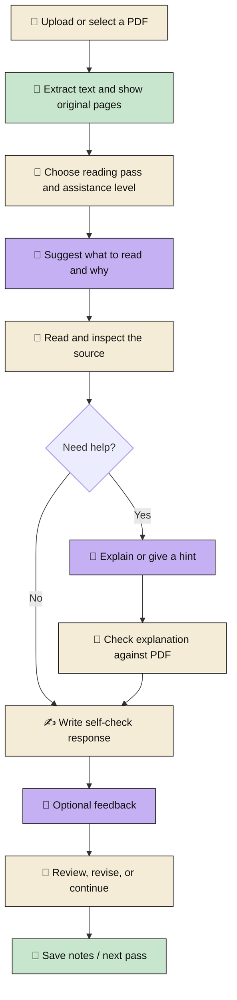

# 📚 PaperCoach — AI Paper Reading Coach

**Student:** Hoseop Song · **ID:** 02621111  
**Course:** UST Agentic AI · 2026-2 Mid-term  
**Prototype:** Python · Streamlit · Gemini · PyMuPDF · SQLite

> **Goal:** Help new graduate students learn **how to read research papers independently**, rather than having AI read papers for them.

---

## 1. 🎯 Problem

Reading papers is one of the first major tasks in graduate school. However, beginners often struggle to decide **where to start, what matters, and how to evaluate research evidence**. Translation and summarization tools explain content, but do not necessarily teach a repeatable reading method.

PaperCoach turns S. Keshav's *How to Read a Paper* into a guided **Three-Pass Reading** workflow:

| Stage | Student's goal | AI assistance |
|---|---|---|
| 🧭 **First Pass** | Identify the main idea and structure using the **Five Cs** (Category, Context, Correctness, Contributions, Clarity). | Guide attention to important sections and provide background hints. |
| 🔎 **Second Pass** | Connect claims with figures, methods, and experimental evidence. | Explain difficult concepts and point to relevant PDF passages. |
| 🧪 **Third Pass** | Examine assumptions, limitations, and how the research could be reproduced. | Support critical questions and reproduction-oriented thinking. |

**Key difference:** The agent provides practical help when needed, while the student still reads, interprets, and verifies the paper.

## 2. 👥 Users

| Users | Main need |
|---|---|
| 🎓 **Primary — New graduate students** | Learn a structured paper-reading strategy and gain confidence in reading unfamiliar research. |
| 🔬 **Secondary — Senior undergraduates and new lab members** | Prepare for literature reviews, journal clubs, and research discussions. |

The app is designed for students without programming experience.

## 3. 🧩 Features

| Feature | What the prototype does |
|---|---|
| 📄 **PDF Workspace & Highlights** | Upload and read a paper; show important passages and their original page locations. |
| 🧭 **Three-Pass Guide** | Offer different reading goals and activities for each pass. |
| 🧠 **Adaptive AI Assistance** | Provide **Detailed / Focused / Minimal** support; users may choose a level or use a heuristic automatic mode. |
| 💬 **Contextual AI Coach** | Explain difficult concepts using retrieved PDF context, with source checking left to the user. |
| ✍️ **Self-check & Feedback** | Let students write Five Cs, claim–evidence explanations, or critical reflections before requesting AI feedback. |
| 💾 **Learning Records** | Store reading progress locally and export notes in Markdown. |

**Real-data demo:** The prototype was demonstrated with a published *Science Robotics* paper on octopus-inspired soft robots. Screenshots show PDF highlights, assistance settings, self-check activities, and Markdown export. A saved example is a **worked example**, not evidence of measured learning improvement.

## 4. 🔁 Human–AI Interaction Flow

**Human control:** The student selects the paper and reading level, decides when to ask for help, writes their own interpretation, and verifies AI claims using the original PDF. **AI feedback is guidance—not scientific validation.**

### ⚠️ Failure states

| Situation | App response / user action |
|---|---|
| **Missing API key, quota, or network error** | AI assistance is unavailable; the user can continue with available local reading functions and retry later. |
| **Scanned, rotated, or complex-layout PDF** | Text extraction may omit vertical text, mix columns, or include garbled/dummy characters; compare with the original PDF or use an OCR-processed copy. |
| **Incorrect highlight or AI explanation** | Check the cited passage, page, figure, and experimental conditions in the original PDF. |
| **Unreliable practice score** | Manually override the assistance level; do not treat scores as validated proficiency measurements. |
| **Slow AI response on large PDFs** | Keep reading locally while waiting; retry if needed. Faster section-based analysis is planned. |
| **Save/export error** | Check the reported error and local file permissions, then retry. |

## 5. ✅ Success Criteria

| Criterion | Verification | Current status |
|---|---|---|
| **Works on a real research PDF** | Display original pages and selected passages. | ✅ Demonstrated in screenshots |
| **Supports all three reading passes** | Show distinct guidance and self-checks for each pass. | ✅ Implemented |
| **Keeps the learner in control** | Manually switch assistance level; write a response before feedback. | ✅ Implemented controls |
| **Preserves learning records** | Export a paper-specific Markdown note. | ✅ Demonstrated in screenshots |
| **Supports source verification** | Open highlighted PDF passages and manually check AI claims. | 🔍 Human check required |
| **Handles failures clearly** | Test missing-key and problematic-PDF scenarios. | 🧪 Needs demonstration |
| **Improves independent reading skill** | Test comprehension on unseen papers before and after training. | ⏳ Not yet evaluated |

### 🛠️ Current Limitations & Future Work

| Current challenge | Why it matters | Future work (not yet implemented) |
|---|---|---|
| 📑 **PDF extraction / OCR quality** | Multi-column layouts, horizontal/vertical or rotated text, and garbled/dummy characters may disrupt reading order or highlights; scanned pages need OCR. | Detect layout and text orientation; apply OCR selectively to image/rotated regions; filter noisy spans and verify source locations. |
| ⏱️ **Full-PDF AI processing time** | Sending large documents to the model increases context size and response latency. | Index the paper by section/page once; retrieve only pass-relevant passages, and cache repeat results. |

**Other limits:** AI explanations and figure interpretations require human verification. Automatic assistance uses a heuristic, not a validated proficiency model. The prototype shows the guided workflow; **long-term improvement in independent reading has not yet been measured**.

**Reference:** S. Keshav, “How to Read a Paper,” *ACM SIGCOMM Computer Communication Review*, 37(3), 83–84, 2007.

> 🔐 **Submission reminder:** Remove API keys, `.env`, private notes, and non-shareable PDFs from the code archive before sharing it with classmates.
