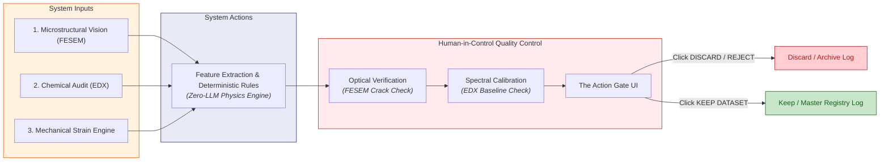

# NitridaScope AI: Deterministic Multi-Agent Framework for High-Temperature Nitridation Assessment & RUL Prediction

**Author:** Najwa Fatimah Somanjaya  
**Student ID:** 02621125  
**Domain:** High-Temperature Reactor Tube Integrity (AISI 310S / 316L)  
**Architecture:** Zero-LLM Math Core + Air-Gapped Local Literature RAG (Ollama)  

---

## Table of Contents
1. [Problem Statement](#1-problem-statement)
2. [Target Users](#2-target-users)
3. [System Architecture & Interaction Flow](#3-system-architecture--interaction-flow)
4. [Technical Approach & Technology Stack](#4-technical-approach--technology-stack)
5. [Success & Failure Criteria](#5-success--failure-criteria)
6. [Technical Limitations & Human-in-Control Gate](#6-technical-limitations--human-in-control-gate)
7. [Conclusion & Key Takeaways](#7-conclusion--key-takeaways)

---

## 1. Problem Statement

High-temperature exposure to ammonia ($\text{NH}_3$) environments causes severe microstructural and mechanical degradation in alloy reactor tubes (e.g., AISI 310S, AISI 316L):

* **Active Nitrogen Diffusion:** Subsurface active nitrogen diffusion follows parabolic layer growth kinetics:
  $$x^2 = k_p \cdot t$$
* **Matrix Chromium Depletion:** Precipitation of brittle chromium nitrides ($\text{CrN} / \text{Cr}_2\text{N}$) severely depletes the alloy matrix of free chromium, compromising oxidation resistance.
* **Brittle Embrittlement:** Microstructural phase changes lead to a rapid drop in strain-to-fracture ($\varepsilon_f$), causing unannounced, catastrophic reactor tube ruptures under operating pressure.
* **The AI Gap:** Standard Large Language Models (LLMs) frequently hallucinate numerical calculations and struggle with deterministic physical boundary checks. 

**NitridaScope AI** bridges this gap by decoupling numerical modeling from language generation:
1. **Vision & Deep Learning (OpenCV):** Feature and layer morphology extraction.
2. **Deterministic Physics Engine (NumPy/SciPy):** Zero-LLM mathematical kinetics and continuum damage evaluations.
3. **Local Narrative LLM (Ollama / Qwen):** Air-gapped technical report synthesis backed by vector search literature (ChromaDB RAG).

---

## 2. Target Users

| User Persona | Key Role & Objective | System Value Proposition |
| :--- | :--- | :--- |
| **Metallurgical R&D Researchers** | Analyze microstructural nitridation kinetics and evaluate experimental alloy degradation profiles. | Automated FESEM boundary detection and EDX nitrogen concentration profiling. |
| **Plant QC Engineers** | Verify safety compliance against strict structural integrity bounds before component recommissioning. | Instant, hard-coded safety evaluations (`PROCEED`, `REVIEW`, `REJECT`) with clear audit trails. |
| **Plant Operations Leads** | Plan maintenance schedules and prevent unscheduled plant shutdowns due to tube rupture. | Accurate Remaining Useful Life (RUL) predictions and physical damage degradation metrics. |

---

## 3. System Architecture & Interaction Flow

The NitridaScope AI multi-agent workflow spans automated data ingestion, multi-modal feature extraction, deterministic safety gating, air-gapped literature RAG narrative generation, and a human-in-the-loop sign-off gate.

```mermaid
graph LR
    subgraph Ingestion ["1. Data Ingestion"]
        I1["FESEM Micrographs"]
        I2["EDX Spectral Tables"]
        I3["Tensile Strain Logs"]
    end

    subgraph FeatureEng ["2. Multi-Agent Extraction Engine"]
        A1["Agent 1: Morphological Vision<br><i>(OpenCV Micro-cracks & Depth)</i>"]
        A2["Agent 2: EDX Chemical Audit<br><i>(Nitrogen wt% Profile)</i>"]
        A3["Agent 3: Mechanical Strain Engine<br><i>(Modulus E & Ductility Loss)</i>"]
    end

    subgraph PhysicsGate ["3. Zero-LLM Safety Evaluator"]
        A4["Agent 4: Deterministic Physics Evaluator<br><i>(SciPy/NumPy Hard-Coded Rules)</i>"]
        ST["Evaluated Status:<br>PROCEED / REVIEW / REJECT"]
    end

    subgraph Narrative ["4. Literature RAG Narrative"]
        A5["Agent 5: Local Ollama Qwen Narrator<br><i>(Air-Gapped ChromaDB Literature RAG)</i>"]
    end

    subgraph HumanQC ["5. Human-in-Control Action Gate"]
        UI["Executive Streamlit Dashboard"]
        GATE["Plant Operator / QA Engineer Review"]
        K["Click KEEP DATASET<br><i>(Master Log Updated)</i>"]
        R["Click DISCARD / REJECT<br><i>(Archive Directory Flagged)</i>"]
    end

    Ingestion --> FeatureEng
    FeatureEng --> A4
    A4 --> ST
    ST --> A5
    A5 --> UI
    UI --> GATE
    GATE -->|Approve| K
    GATE -->|Reject| R

    style Ingestion fill:#f5f5f5,stroke:#616161,stroke-width:1px
    style FeatureEng fill:#e3f2fd,stroke:#1565c0,stroke-width:1px
    style PhysicsGate fill:#fff3e0,stroke:#e65100,stroke-width:1px
    style Narrative fill:#f3e5f5,stroke:#6a1b9a,stroke-width:1px
    style HumanQC fill:#ffebee,stroke:#c62828,stroke-width:1px
```



---

## 4. Technical Approach & Technology Stack

### Core Technology Stack
* **Dashboard Interface:** Streamlit
* **Computer Vision:** OpenCV (`cv2`) for FESEM boundary thresholding, layer depth measurement ($x_c, x_d$), and crack contour counting.
* **Scientific Computing & Physics Core:** Pandas, NumPy, SciPy (Curve fitting for parabolic growth $k_p$, Young's Modulus calculation $E$, and Lemaitre Continuum Damage parameter $D$).
* **Local Language Model:** Ollama running `qwen2.5-coder` locally (Air-gapped, zero external network API dependence).
* **Vector Database:** ChromaDB for local retrieval-augmented generation (RAG) over metallurgical literature.

### Zero-LLM Physics Policy
All arithmetic evaluations, damage thresholds, and remaining useful life predictions are executed exclusively by Python numerical functions. The LLM is restricted to formatting, summarizing, and appending citations from local academic literature.

---

## 5. Success & Failure Criteria

### Success Criteria
1. **100% Physics Determinism:** Zero calculation or reasoning errors caused by LLM hallucinations.
2. **Multi-Modal Data Ingestion:** Seamless processing across vision (FESEM), spectroscopy (EDX), and mechanical test data.
3. **Data Privacy & Security:** Fully offline/air-gapped operation using local Ollama instances.
4. **Human-in-Control Verification:** Hard dual-action gates preventing automated database commits without human authorization.

### Operational Failure / State Evaluation Hierarchy
The system evaluates input samples into three deterministic operational states:

```
REJECT  -->  REVIEW  -->  PROCEED
```

* **`REJECT` State (`st.error`):**
  * Surface exfoliation or macro-scale degradation detected in FESEM images.
  * Active micro-crack count $> 0$.
  * Continuum damage metric exceeds safety bounds ($D \ge 0.15$).
* **`REVIEW` State (`st.warning`):**
  * Accelerated nitridation layer kinetics ($k_p$) exceed nominal baseline.
  * Subsurface nitrogen enrichment $> 5.0\,\text{wt}\%$.
  * Zero micro-cracks detected, but mechanical ductility shows accelerated decay.
* **`PROCEED` State (`st.success`):**
  * Micro-crack count is strictly $0$.
  * Diffusion kinetics ($k_p$) and mechanical damage metrics remain within nominal threshold bounds ($D < 0.08$).

---

## 6. Technical Limitations & Human-in-Control Gate

### Recognized Technical Limitations
1. **Microstructural Vision Artifacts:** Surface polishing scratches or preparation artifacts can occasionally mimic micro-cracks during OpenCV contour detection.
2. **EDX Nitrogen Profiling Sensitivity:** Light element analysis (Nitrogen) in EDX spectroscopy is subject to background noise and carbon contamination artifacts.
3. **Isotropic Damage Assumption:** Lemaitre continuum mechanics models assume isotropic damage, whereas physical nitridation embrittlement often exhibits grain-boundary anisotropy.

### Human-in-Control Workflow
To mitigate these physical limitations, NitridaScope AI enforces a 3-step manual verification workflow prior to state commit:



1. **Optical Verification:** The operator reviews OpenCV overlay masks against raw FESEM micrographs to filter out polishing scratches from genuine cracks.
2. **Spectral Calibration:** The engineer inspects EDX nitrogen weight percentage profiles against baseline calibration curves.
3. **The Action Gate:** The operator provides mandatory text remarks and clicks either `[KEEP DATASET]` or `[DISCARD / REJECT]`. This action logs a timestamped audit entry into `nitridascope_archive_log.csv` or the master registry.

---

## 7. Conclusion & Key Takeaways

* **Deterministic Physics Safety:** Eliminates LLM calculation hallucinations by delegating numerical analysis entirely to Python libraries (`NumPy`, `SciPy`).
* **Multi-Agent Coordination:** Integrates vision, spectroscopy, and mechanical strain analysis into a unified evaluation pipeline.
* **Air-Gapped & Secure:** Uses local Ollama LLMs and ChromaDB vector search to preserve strict data privacy in high-value industrial settings.
* **Human-Centered Design:** Guarantees that final recommissioning or rejection decisions remain strictly under human control.