## Slide: Title
- type: title
- title: Mid-term Evaluation: Proposal
- subtitle: Video Pitch Screening & Peer Review — Assessing the Feasibility of Your Colleagues' Agentic AI Systems

> Week 8 of Phase 2: Workflow Automation & Design (Weeks 5-8)

=====

## Slide: Contents
- type: cards
- title: Contents
- subtitle: A different kind of session — your work is the lecture today

- card(blue, 📖): 1. Lecture (short)
  - What a proposal of an Agentic AI system has to show
  - The four criteria, and how a reviewer reads a 3–5 minute pitch

- card(green, 🎬): 2. Screening
  - The merged video pitches, played in class
  - Everyone scores every project while watching

- card(orange, 🗣️): 3. Peer Review
  - Feasibility discussion: can this be built, and would anyone use it?
  - Written feedback to each author, then the Phase 3 preview

- flow: Lecture (15 min) → Screening (60–70 min) → Peer Review & Discussion (30 min) → Phase 3 preview

=====

# Part 1: Lecture

## Slide: Where We Are
- type: cards
- title: Phase 2 Complete — **From Literacy to a Built Proposal**
- subtitle: Eight weeks in, you have designed, specified, and recorded a working system

- card(blue, 🧱): What You Have Built
  - Week 5: the **5-question specification** (Problem, Users, Features, Interaction Flow, Success Criteria) and a Streamlit UI
  - Week 6: **data intake** — PDFs to structured metadata, scored against hand labels
  - Week 7: **data output** — numbers from code, sentences from the model, every digit verified
  - Midterm: all of it, pointed at **your own research problem**

- card(green, 🎯): What Today Tests
  - Not whether the code is pretty — whether the **proposal** is sound
  - Does a real researcher have this problem? Would the app survive contact with real data?
  - Where does the human stay in control, and is that visible on screen?

- card(orange, 🔁): Why Peer Review
  - Week 1: you argued AI is an assistant when a human can **explain, verify and take responsibility**
  - Today you apply that test to a colleague's system — and receive it on your own
  - Reviewing is a research skill: the same questions you will face from a journal or a funding panel

=====

## Slide: What a Proposal Must Show
- type: cards
- title: Proposal of an Agentic AI System — **What Must Be On Screen**
- subtitle: The reviewer has 3–5 minutes; make each of these impossible to miss

- card(blue, ❓): The Problem and the User
  - A specific task a specific researcher does today, and what it costs them (time, errors, tedium)
  - Not "a chatbot for chemistry" — "the two hours I spend reconciling corrosion rates across papers with different test conditions"
  - Who clicks the buttons: you alone, your lab, your field?

- card(green, 🔀): The Interaction Flow
  - Human does X → AI does Y → human **reviews** → … — the flow from your spec, shown live
  - Which steps are Green (autonomous), Yellow (AI proposes, human approves), Red (human only)?
  - The Week 4 `CONFIRM_REQUIRED` idea: where is the checkpoint in **your** app?

- card(orange, 🧪): Real Data and Failure States
  - The app running on data from your research, not placeholder text
  - What happens when input is unusable, the model declines, or a number cannot be verified?
  - Honest limits: what the human still has to check after the app finishes

- highlight-quote: "Delegating execution to AI should never mean abdicating our intellectual ownership and ethical responsibility." — Minh Le Tran, Week 4 forum. A proposal shows where that ownership lives in the interface.

=====

## Slide: The Four Criteria
- type: compare-table
- title: Evaluation Criteria — **Four Dimensions, 0–3 Each** (max 12)
- subtitle: The same rubric for instructor grading and your peer review

| Criterion | 0 | 1 | 2 | 3 |
|-----------|---|---|---|---|
| **Creativity** | Generic chatbot wrapper | Known pattern applied as-is | Known pattern adapted to the research problem | A new idea or combination that others would want to copy |
| **Usefulness** | Does not address a real research task | Addresses a task, but no one would use it in practice | Would save real time or errors in the author's own work | Would be useful to other researchers in the field too |
| **Concreteness** | Spec and prototype do not match; app does not run | App runs on dummy data only | App runs on real data; human control points are visible | Real data, failure states handled, verification built into the flow |
| **Presentation** | Video missing or app not shown running | App shown, design decisions not explained | Clear problem, demo, and design rationale within 3–5 min | Also honest about limitations and what the human still has to check |

- highlight-quote: Score what you **saw**, not what you assume was built. If the video does not show it, it does not count.

> 📚 [Mid-term Project — Submission Notice (GitHub)](https://github.com/MIRAE-Laboratory/UST_Lecture_AgenticAI/blob/main/Mid-term_Project_Notice.md)

=====

## Slide: How to Read a Pitch
- type: cards
- title: How a Reviewer **Reads a 3–5 Minute Pitch**
- subtitle: A protocol so that ten pitches get the same attention as the first

- card(blue, ⏱️): Minute 0–1 — The Problem
  - Can you restate the problem in one sentence after the first minute? If not, note it under Presentation
  - Is it the author's own problem (Usefulness 2) or a field-wide one (Usefulness 3)?

- card(green, ⏱️): Minute 1–4 — The Demo
  - Watch the **hands**, not the slides: real data in, what comes out, where the human intervenes
  - Look for one failure state handled on screen — that is the Concreteness 2 → 3 step
  - Is anything new here, or a known pattern reused? (Creativity)

- card(orange, ⏱️): Minute 4–5 — The Decisions
  - Why these tools, this flow, this checkpoint? A reason per decision = Presentation 2
  - Do they name what the human must still check afterwards? That is Presentation 3

- card(purple, ✍️): While Watching
  - Fill the score sheet **during** the pitch, not after the next one starts
  - Write one sentence of feedback the author can act on: a question you would ask as their PI
  - Do not score your own pitch; do not confer until the screening block ends

=====

## Slide: Screening Rules
- type: cards
- title: Part 2 — **Screening**
- subtitle: The merged video, played in submission order

- card(blue, 🎬): Format
  - Pitches are merged into one video and screened in class; the specifications (and code where permitted) are in the course **GitHub repository**
  - 3–5 minutes each, roughly 60–70 minutes in total, with a short pause after every third pitch
  - Nothing runs live today, so nothing can break live — the recording is the demo

- card(green, 📝): Your Job During Screening
  - One score sheet per project: four criteria, 0–3 each, plus one actionable comment
  - Flag any project whose **feasibility** you doubt — we discuss those first in Part 3
  - Note one idea from a colleague you would **borrow** for your own final project

- card(orange, 🤝): Ground Rules
  - Feedback addresses the **system**, not the person; be specific ("the checkpoint before export is missing"), not global ("not useful")
  - Everything shared today stays in the class: no re-posting of videos or code
  - Authors listen first and answer questions after the discussion block

=====

# Part 2: Screening

## Slide: Screening
- type: title
- title: Part 2: **Video Pitch Screening**
- subtitle: 3–5 minutes each — score as you watch

=====

## Slide: Score Sheet
- type: card-single
- title: 📋 **Score Sheet** — One Per Project
- subtitle: Copy this for every pitch (paper or the shared form)

- card(yellow, 📝): Fields
  - **Project / author**:
  - **Creativity (0–3)**: ___  — what is new or well-adapted here?
  - **Usefulness (0–3)**: ___  — who would actually use it, and how often?
  - **Concreteness (0–3)**: ___  — real data? failure state shown? human control points visible?
  - **Presentation (0–3)**: ___  — problem clear in one minute? decisions explained? limits named?
  - **Feasibility flag** (yes / no): can this be completed as a final project in 7 weeks with the resources the author has?
  - **One question I would ask as their PI**:
  - **One idea I would borrow**:

=====

## Slide: Feasibility Lens
- type: cards
- title: The **Feasibility** Question
- subtitle: Today's discussion topic — assessing what your colleagues can realistically build

- card(blue, 🔬): Technical Feasibility
  - Does the model actually have to do what the pitch claims, or is there a deterministic path (code, a database API) for part of it? (Week 7: numbers from code)
  - Is the data available, and in a format the pipeline can ingest? (Week 6: PDF traps data)
  - How often will it hallucinate on this task, and does the design **catch** it?

- card(green, 👤): Human Feasibility
  - Will the intended user tolerate the checkpoints, or click through them? (Week 5: verification must not feel like extra work)
  - Does using the app require a skill the user may lose by using it? (Week 6 forum: "the deeper the dependence, the deeper the reading")
  - Who is accountable when it is wrong — is that person visible in the flow?

- card(orange, 📅): Project Feasibility
  - Seven weeks remain until the final showcase. What is the **minimum** version that proves the idea?
  - Which Phase 3 topic does it need most: workflow design (Week 9), evaluation (Week 10), self-correction (Week 11), or memory/RAG (Week 12)?

=====

# Part 3: Peer Review

## Slide: Peer Review
- type: title
- title: Part 3: **Peer Review & Discussion**
- subtitle: Assessing the feasibility of your colleagues' systems

=====

## Slide: Discussion Activity
- type: card-single
- title: 🗣️ **Live Discussion** — Feasibility Round
- subtitle: 30 minutes — flagged projects first, then open floor

- card(yellow, 💡): Protocol
  - **Round 1 (10 min)**: projects with two or more feasibility flags. One reviewer states the doubt in one sentence; the author answers in one minute; the class votes: feasible as proposed / feasible if narrowed / rethink
  - **Round 2 (10 min)**: the three highest-scored projects. What made them concrete? Name the single design choice others should copy
  - **Round 3 (10 min)**: pairs. Exchange score sheets with the author of the project you reviewed most critically. Each author rewrites their Success Criteria in one sentence based on the feedback
  - Hand in all score sheets at the end — the instructor grade uses the same rubric, and your reviews feed into the author's feedback

=====

## Slide: Giving Feedback That Lands
- type: cards
- title: Feedback That the Author Can **Use**
- subtitle: The Week 1 accountability test, turned outward

- card(blue, ✅): Say This
  - "Your checkpoint comes after export; move it before" — a location and an action
  - "The demo used synthetic rows; show one real dataset and its failure case" — a concrete next step
  - "The problem statement is a field-wide one; say so, that is Usefulness 3" — credit where earned

- card(pink, ❌): Not This
  - "Interesting but not practical" — nothing to act on
  - "Just add RAG" — a tool without a reason
  - Scores without a comment — the number alone does not teach anything

- card(green, 🎯): The Test
  - Would you accept this comment from a reviewer on your own paper?
  - Could the author do something about it **this week**?
  - Does it address the system, the data, or the flow — never the person

=====

## Slide: Phase 3 Preview
- type: card-single
- title: Phase 3 — **Management & Reliability** (Weeks 9–12)
- subtitle: From a working proposal to a system you can trust

```mermaid
graph LR
    subgraph "Phase 2: Building ✅"
        W5["Week 5<br>🖥️ Human-AI Interaction"]
        W6["Week 6<br>📥 Data Input"]
        W7["Week 7<br>📤 Data Output"]
        W8["Week 8<br>🎯 Mid-term Proposal"]
    end
    subgraph "Phase 3: Management & Reliability"
        W9["Week 9<br>🧭 Task & Workflow Design"]
        W10["Week 10<br>📏 Evaluating Agent Output"]
        W11["Week 11<br>🔁 Self-feedback Loop"]
        W12["Week 12<br>🧠 Memory & RAG"]
    end
    W5 --> W6 --> W7 --> W8 --> W9 --> W10 --> W11 --> W12
    style W5 fill:#e1f5fe,stroke:#0288d1
    style W6 fill:#e1f5fe,stroke:#0288d1
    style W7 fill:#e1f5fe,stroke:#0288d1
    style W8 fill:#e1f5fe,stroke:#0288d1
    style W9 fill:#e8f5e9,stroke:#388e3c
    style W10 fill:#e8f5e9,stroke:#388e3c
    style W11 fill:#e8f5e9,stroke:#388e3c
    style W12 fill:#e8f5e9,stroke:#388e3c
```

- highlight-quote: "Phase 2 asked: can you build it? Phase 3 asks: can you make it reliable — a workflow that survives vague requests, an evaluation that catches bad output, an agent that fixes its own errors, and a memory that remembers the right things."

=====

## Slide: Discussion Questions
- type: card-single
- title: 🗣️ **Week 8 Discussion Questions** (UST LMS)
- subtitle: Post your response on the forum this week

> Visit: **UST LMS → Class → Discussion**

1. **Peer feedback, received.** Summarize the feedback you got today in three bullets. Which one changes your plan for the final project, and which one do you (respectfully) reject, and why?
2. **Peer feedback, given.** Which colleague's project did you rate highest on **Concreteness**, and what exactly did they show on screen that earned it? What would it take for yours to match?
3. **Feasibility.** Based on today's discussion, write the **minimum version** of your final project in five lines: problem, one input, one output, one human checkpoint, one failure state handled. This becomes your Phase 3 starting point.
4. Looking at the Phase 3 topics (workflow design, evaluation, self-correction, memory), which one does your project need most urgently, and what currently breaks because you do not have it?

=====

## Slide: Recommended Resources
- type: card-single
- title: Want to Learn More?

Mid-term
> 📚 [Mid-term Project — Submission Notice & Rubric (GitHub)](https://github.com/MIRAE-Laboratory/UST_Lecture_AgenticAI/blob/main/Mid-term_Project_Notice.md)
> 📚 [Course repository — specifications of submitted projects](https://github.com/MIRAE-Laboratory/UST_Lecture_AgenticAI)
&nbsp;

Reviewing and Proposing
> 📚 [Google PAIR — People + AI Guidebook](https://pair.withgoogle.com/guidebook)
> 📚 [Microsoft HAX Toolkit — Human-AI Interaction Guidelines](https://www.microsoft.com/en-us/haxtoolkit/)
> 📚 [Anthropic — Building Effective Agents](https://www.anthropic.com/engineering/building-effective-agents)
&nbsp;

Looking Ahead to Phase 3
> 📚 [Anthropic — Writing Effective Tools for AI Agents](https://www.anthropic.com/engineering/writing-tools-for-agents)
> 📚 [OpenAI — Evals guide](https://developers.openai.com/api/docs/guides/evals)

=====

## Slide: Wrap-Up
- type: cards
- title: Wrap-Up of **Week 8**
- subtitle: Three things to remember

- card(blue, 📖): Proposal
  - A proposal of an Agentic AI system shows a **real problem**, a **visible interaction flow** with human checkpoints, **real data**, and its **failure states** — in 3–5 minutes

- card(green, 🎬): Screening & Review
  - Four criteria, 0–3 each; score what you saw; one actionable comment per project; feasibility flags drive the discussion

- card(orange, 🗣️): Discussion
  - Feasibility is technical, human, and project-level at once; the best feedback names a location and an action; your minimum final-project version goes on the forum this week

**Phase 2 complete!** Next week begins Phase 3: Management & Reliability — starting with **Design of Task and Workflow**: turning a vague request into a flow that survives contact with reality.
