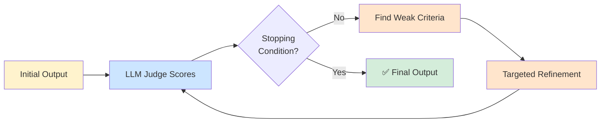

## Slide: Title
- type: title
- title: Evaluation of LLM Outputs
- subtitle: Rubrics, LLM-as-Judge, and Iterative Improvement Loops

> Week 10 of Phase 3: Management & Reliability (Weeks 9-12)

=====

## Slide: Contents
- type: cards
- title: Contents
- subtitle: Lecture, Practice, and Discussion for Week 10

- card(blue, 📖): 1. Lecture
  - The evaluation gap — we build, but how do we measure quality?
  - LLM-as-a-Judge — using LLMs to score LLM outputs
  - Three strategies: naive, refine, aware; then iterate

- card(green, 💻): 2. Practice
  - Build a **Hometown Introduction Generator**
  - Compare 3 generation strategies + multi-model evaluation + iterative loop

- card(orange, 🗣️): 3. Discussion
  - Week 9 — Ambiguity vs Clarity: why agents fail at vague tasks
  - Connection: rubrics as disambiguation mechanism

=====

# Part 1: Lecture

## Slide: Lecture
- type: title
- title: Part 1: **Lecture**
- subtitle: How to Measure Whether an LLM Output is Good

=====

## Slide: The Evaluation Gap
- type: cards
- title: The **Evaluation Gap** — Where We Are

- card(blue, 📄): What We've Built So Far
  - Week 5-7: chat UI, extracted metadata, auto-drafted reports
  - Week 9: multi-step workflows with explicit acceptance criteria
  - All produce outputs — but how good are they?

- card(red, ❓): The Uncomfortable Question
  - "Looks good to me" — but is that enough?
  - Different LLMs give different answers — which is best?
  - You changed the prompt — did it actually improve?
  - Without measurement, you're flying blind

- card(green, 🎯): Today's Goal
  - Turn "good" from a feeling into a **score**
  - Build a system that **measures itself**, then **improves itself**

=====

## Slide: The Subjective Problem
- type: cards
- title: Why Evaluating LLMs is **Hard**

- card(red, 🤔): "Good" is Subjective
  - "Write me a report on Seoul" → infinite valid answers
  - No single ground truth like math problems
  - Reasonable people disagree on what's "best"

- card(blue, 💡): The Trick — Operationalize "Good"
  - Don't try to define "good" in one word
  - Break it into **measurable criteria**: completeness, accuracy, structure, engagement
  - Each criterion gets a score → total = quality estimate

- card(orange, 📋): This is a Rubric
  - Same idea as a grading rubric in school
  - Subjective overall, but each criterion is concrete enough to score
  - Once you have a rubric, you can measure ANYTHING

=====

## Slide: LLM-as-a-Judge
- type: cards
- title: **LLM-as-a-Judge** — The Core Idea

- card(blue, 🧑‍⚖️): The Setup
  - You have an output from LLM A
  - You ask LLM B (the judge): "Score this on these criteria"
  - LLM B returns numerical scores per criterion
  - Average = quality estimate

- card(green, ✅): Why It Works
  - LLMs are good at applying explicit criteria to text
  - Cheap and fast (vs hiring human raters)
  - Reproducible (same input → similar score)

- card(orange, ⚠️): Limits to Know
  - Same model judging itself = biased (likes its own style)
  - Use a **different model** as judge when possible
  - Judge can be wrong — sanity check on a few examples

=====

## Slide: Three Generation Strategies
- type: cards
- title: Three Strategies — **Where Does the Rubric Go?**

- card(red, 1️⃣): Naive — Just Ask
  - "Write an introduction to my hometown"
  - No criteria mentioned, LLM guesses what's wanted
  - Baseline — simplest possible approach

- card(orange, 2️⃣): Refine — Ask Then Improve
  - Step 1: get a draft (naive)
  - Step 2: "Here's a draft, here's the rubric — rewrite to score better"
  - Two LLM calls, but the rubric is applied AFTER

- card(green, 3️⃣): Aware — Include Rubric Upfront
  - "Write an introduction. It will be scored on these criteria: [rubric]"
  - Single LLM call, rubric embedded in the request
  - The model knows the test before it writes

- highlight-quote: "Same task, three ways to use the rubric. Which gives the highest score?"

=====

## Slide: The Iterative Loop
- type: card-single
- title: The **Iterative Loop** — Generate, Score, Improve



- card(yellow, 💡): Two Stopping Strategies
  - **Threshold mode** — stop when all criteria ≥ target (e.g., all ≥ 8)
  - **Self-evolving mode** — keep going until best score hasn't improved in N iterations (patience)
  - Threshold = "good enough"; Self-evolving = "push to the ceiling"

=====

## Slide: Self-Evolving Mode
- type: cards
- title: **Self-Evolving Mode** — Push Beyond "Good Enough"
- subtitle: Track the best, refine from the best, stop on no improvement

- card(blue, 📈): Track the Best
  - Don't just look at the **latest** iteration
  - Keep a record of the **highest-scoring output so far**
  - The latest iteration may have **regressed** — that's OK, we keep the best

- card(orange, 🔄): Refine FROM the Best, Not the Latest
  - At each iteration, refine starting from the **best text**, not the last one
  - This prevents the loop from drifting downward after a bad refinement
  - Conceptually: hill-climbing with memory

- card(green, ⏱️): Patience-Based Stopping
  - Set `patience = 3` — wait 3 iterations for a new best
  - If 3 consecutive iterations don't beat the best → stop
  - You've likely hit the model's ceiling for this task

- highlight-quote: "Threshold says 'I'm done when it's good enough.' Self-evolving says 'I'm done when I can't make it any better.'"

=====

## Slide: Multi-Model Comparison
- type: cards
- title: **Multi-Model Comparison** — Same Task, Different Models

- card(blue, 🔬): Why Compare Models?
  - GPT-4, Claude, Gemini, Llama — all give different answers
  - Some are better at facts, others at structure, others at style
  - Without measurement, you'd just pick one and hope

- card(orange, 📊): The Setup
  - Run the same prompt on N models
  - Score each output with the **same rubric** (using the same judge)
  - Plot: model on x-axis, score per criterion on y-axis
  - Now you can pick the right model for the right task

- card(green, ⚠️): Important — Use One Judge
  - Different judges give different absolute scores
  - For comparison, judge MUST be consistent across all candidates
  - Best: use a strong model as judge that didn't generate any candidate

=====

## Slide: Lecture Summary
- type: cards
- title: Lecture Summary — **Evaluation**

- card(blue, 📋): Rubrics
  - Operationalize "good" into measurable criteria
  - Same idea as grading rubrics, applied to AI outputs
  - This is the bridge from subjective to scorable

- card(green, 🧑‍⚖️): LLM-as-a-Judge
  - Use one LLM to score another's output
  - Use a different model as judge to avoid self-bias
  - Cheap, fast, reproducible — but verify on samples

- card(orange, 🔁): Three Strategies + Two Loop Modes
  - Naive / Refine / Aware — three ways to use a rubric
  - **Threshold mode**: stop when good enough; **Self-evolving mode**: refine FROM best, stop on patience
  - Multi-model comparison picks the right tool for the job

=====

# Part 2: Practice

## Slide: Practice
- type: title
- title: Part 2: **Practice**
- subtitle: Hometown Introduction — Generate, Score, Improve

=====

## Slide: Practice Overview
- type: cards
- title: Practice Overview — **What We'll Build**

- card(blue, 🎯): The Task
  - Generate an **introduction to your hometown** (1 paragraph)
  - Score it with a 5-criterion rubric
  - Compare 3 strategies + multiple models + iterative loop

- card(green, 📁): New File
  - `evaluator.py` — rubric, generation strategies, judge, loop
  - `app.py` — add Tab 8: Evaluation Lab

- card(orange, ⚡): Why Hometown?
  - Concrete (you know the ground truth — your own town)
  - Quality is genuinely subjective (good for rubric practice)
  - Different aspects (history / food / geography) → multi-criterion natural

=====

## Slide: The Rubric
- type: practice
- title: Step 1 — **Define the Rubric** (`evaluator.py`)
- subtitle: Five criteria, each with an explicit definition

```python
# evaluator.py
RUBRIC = {
    "completeness": (
        "Covers multiple aspects: history, culture, food, geography, and people. "
        "Score 0 if only one aspect; 10 if all five are present."
    ),
    "specificity": (
        "Uses concrete details (place names, dishes, festivals) rather than generic claims. "
        "Score 0 for vague platitudes; 10 for vivid specifics."
    ),
    "structure": (
        "Has logical flow with a clear opening, body, and closing. "
        "Score 0 for disorganized text; 10 for well-paragraphed prose."
    ),
    "engagement": (
        "Reads as something someone would WANT to read, not a list of facts. "
        "Score 0 for dry encyclopedia tone; 10 for vivid storytelling."
    ),
    "accuracy_caution": (
        "Avoids confident claims that could be wrong (specific dates, statistics). "
        "Score 0 if it invents specific facts; 10 if it stays within safe knowledge."
    ),
}
```

- card(yellow, 💡): Each Criterion is Self-Contained
  - Has a name, a definition, and a scoring rule
  - The judge doesn't need to guess what "engagement" means
  - This is the disambiguation work

=====

## Slide: Three Strategies Code
- type: practice
- title: Step 2 — **Three Generation Strategies**
- subtitle: One small `llm_call` helper, three different prompts

```python
# evaluator.py — using google-genai SDK
def llm_call(client, model, prompt):
    """Single-turn call to a Gemini model."""
    resp = client.models.generate_content(
        model=model,
        contents=prompt,
    )
    return resp.text


def generate_naive(client, model, hometown):
    """Strategy 1: just ask, no rubric."""
    return llm_call(client, model, f"Write a 1-paragraph introduction to {hometown}.")


def generate_aware(client, model, hometown):
    """Strategy 3: include rubric in the prompt upfront."""
    rubric_text = "\n".join(f"- {k}: {v}" for k, v in RUBRIC.items())
    prompt = f"""Write a 1-paragraph introduction to {hometown}.

Your output will be scored on these criteria:
{rubric_text}

Address each criterion in your writing."""
    return llm_call(client, model, prompt)


def generate_refine(client, model, hometown):
    """Strategy 2: generate first, then refine with rubric."""
    draft = generate_naive(client, model, hometown)
    rubric_text = "\n".join(f"- {k}: {v}" for k, v in RUBRIC.items())
    prompt = f"""Original draft:
{draft}

Rewrite this to score better on these criteria:
{rubric_text}"""
    return llm_call(client, model, prompt)
```

- card(yellow, 💡): SDK Note
  - Uses `google-genai` (native Gemini SDK), not OpenAI-compatible
  - `client.models.generate_content(model=..., contents=...)` — single string in, `.text` out
  - All later functions reuse this single `llm_call` helper

=====

## Slide: LLM Judge Code
- type: practice
- title: Step 3 — **The LLM Judge** (`evaluator.py`)
- subtitle: Same rubric, structured JSON output

```python
import json, re

def evaluate(client, judge_model, text):
    """Score text on each rubric criterion (0-10)."""
    rubric_text = "\n".join(f"- {k}: {v}" for k, v in RUBRIC.items())
    prompt = f"""Score the following text on each criterion (0-10 integer).

Text:
{text}

Criteria:
{rubric_text}

Return ONLY a JSON object like:
{{"completeness": 7, "specificity": 8, "structure": 6, "engagement": 7, "accuracy_caution": 9}}"""

    raw = llm_call(client, judge_model, prompt)
    # Extract JSON from response (LLMs sometimes wrap it in code blocks)
    match = re.search(r"\{[^}]+\}", raw, re.DOTALL)
    if not match:
        return {k: 0 for k in RUBRIC}
    try:
        return json.loads(match.group(0))
    except json.JSONDecodeError:
        return {k: 0 for k in RUBRIC}
```

- card(yellow, 💡): Robust Parsing
  - LLMs may add commentary around JSON — extract with regex
  - Fall back to zero scores on parse failure (visible in UI)
  - For production: add retries with stricter formatting prompts

=====

## Slide: App Setup
- type: practice
- title: Step 4a — **App Setup** (`app.py` — top of file)
- subtitle: Standalone Streamlit app — client, model, imports

```python
# app.py
import os
from dotenv import load_dotenv
from google import genai

load_dotenv()

client = genai.Client(api_key=os.environ.get("GOOGLE_API_KEY"))
model = os.environ.get("LLM_MODEL", "gemini-3.1-flash-lite")

import streamlit as st
import pandas as pd, altair as alt
from evaluator import (
    RUBRIC, generate_naive, generate_aware, generate_refine, evaluate,
    iterative_threshold, iterative_self_evolving
)
```

- card(yellow, 💡): Why a Standalone App?
  - This week's evaluator is independent of Weeks 5-7 (no shared tabs)
  - Run with `streamlit run app.py` — fresh single-page UI
  - `LLM_MODEL` env var lets you swap the generator without editing code

=====

## Slide: Compare Strategies UI
- type: practice
- title: Step 4b — **UI: Compare 3 Strategies**
- subtitle: Header, hometown input, judge selector, then run all three

```python
st.header("📊 Evaluation Lab — Hometown Introductions")
hometown = st.text_input("Your hometown", "Daejeon, South Korea")
judge = st.selectbox(
    "Judge model",                       # IDs change — check the model library
    ["gemini-3.1-flash-lite", "gemini-3.8-flash"],
)

if st.button("🚀 Run All 3 Strategies", disabled=not hometown):
    rows = []
    for name, fn in [
        ("Naive", generate_naive),
        ("Refine", generate_refine),
        ("Aware", generate_aware),
    ]:
        with st.spinner(f"{name}..."):
            text = fn(client, model, hometown)
            scores = evaluate(client, judge, text)
        st.subheader(f"{name} Strategy")
        st.write(text)
        st.json(scores)
        for k, v in scores.items():
            rows.append({"strategy": name, "criterion": k, "score": v})

    df = pd.DataFrame(rows)
    chart = alt.Chart(df).mark_bar().encode(
        x="score:Q", y="criterion:N", color="strategy:N", row="strategy:N",
    )
    st.altair_chart(chart, use_container_width=True)
```

- card(yellow, 💡): Run This First
  - Confirms rubric + judge + 3 strategies all work
  - Building block for the iterative loops next
  - Different model for **generation** (`model`) and **judging** (`judge`) — avoids self-bias

=====

## Slide: Threshold Loop Code
- type: practice
- title: Step 5a — **Threshold Loop** (function in `evaluator.py`)
- subtitle: The simplest improvement loop — stop when good enough

```python
def iterative_threshold(client, gen_model, judge_model, hometown,
                        max_iters=4, threshold=8):
    """Generate → score → refine weak criteria. Stop when all ≥ threshold."""
    text = generate_aware(client, gen_model, hometown)
    history = []

    for i in range(max_iters):
        scores = evaluate(client, judge_model, text)
        avg = sum(scores.values()) / len(scores)
        history.append({"iter": i, "text": text, "scores": scores, "avg": avg})

        weak = [k for k, v in scores.items() if v < threshold]
        if not weak:
            break  # all criteria above threshold → done

        weak_defs = "\n".join(f"- {k}: {RUBRIC[k]}" for k in weak)
        prompt = f"""Current text:
{text}

It scored low on these criteria:
{weak_defs}

Rewrite the text to specifically improve these aspects. Keep what works."""
        text = llm_call(client, gen_model, prompt)

    return history
```

- card(yellow, 💡): The Logic
  - At each iteration, identify weak criteria (below threshold)
  - Refine targeting only those criteria
  - Exit as soon as all criteria are above the bar — "good enough"

=====

## Slide: Threshold Loop UI
- type: practice
- title: Step 5b — **UI: Threshold Loop** (append to `app.py`)
- subtitle: Run this section by itself — independent button

```python
# Append below the Compare-Strategies block
st.divider()
st.subheader("🎯 Threshold Loop")

th_max_iters = st.slider("Max iterations", 1, 10, 4, key="th_iters")
th_threshold = st.slider("Threshold per criterion", 5, 10, 8, key="th_th")

if st.button("🔁 Run Threshold Loop"):
    with st.spinner("Iterating..."):
        history = iterative_threshold(
            client, model, judge, hometown,
            max_iters=th_max_iters, threshold=th_threshold,
        )

    # Score trajectory per criterion
    traj = pd.DataFrame([
        {"iter": h["iter"], "criterion": k, "score": v}
        for h in history for k, v in h["scores"].items()
    ])
    line = alt.Chart(traj).mark_line(point=True).encode(
        x="iter:O", y="score:Q", color="criterion:N",
    )
    st.altair_chart(line, use_container_width=True)

    final = history[-1]
    st.subheader(f"Final — iter {final['iter']}, avg {final['avg']:.1f}")
    st.write(final["text"])
    st.json(final["scores"])
```

- card(yellow, 💡): What to Observe
  - Does the loop stop early (all ≥ threshold) or run to max?
  - Which criteria are the last to clear?
  - Try lowering threshold to 7 — does it stop faster?

=====

## Slide: Beyond Threshold
- type: cards
- title: One Step Further — **Why Threshold Isn't Always Enough**
- subtitle: From "good enough" to "best possible"

- card(red, ⚠️): Threshold Mode Limits
  - Stops at the FIRST output where all scores clear the bar
  - Doesn't try to keep improving past that point
  - The latest iteration may also have regressed in some criteria

- card(blue, 💡): What If We Want the BEST?
  - Track the highest-scoring output seen so far (`best`)
  - Each refinement starts from `best`, not from `latest`
  - Stop only when we can't beat `best` for N rounds (patience)
  - This is **self-evolving** — pushing to the ceiling

- card(green, 🎯): When to Use Each
  - **Threshold**: production tasks where "passing the bar" is the goal
  - **Self-evolving**: research/exploration when you want maximum quality

=====

## Slide: Self-Evolving Loop Code
- type: practice
- title: Step 6a — **Self-Evolving Loop** (function in `evaluator.py`)
- subtitle: Track best, refine from best, patience-based stopping

```python
def iterative_self_evolving(client, gen_model, judge_model, hometown,
                            max_iters=10, patience=3):
    """Track best, refine FROM best, stop when best hasn't improved in `patience` iters."""
    text = generate_aware(client, gen_model, hometown)
    history = []
    best = {"avg": -1, "text": "", "scores": {}, "iter": -1}
    no_improve = 0

    for i in range(max_iters):
        scores = evaluate(client, judge_model, text)
        avg = sum(scores.values()) / len(scores)
        history.append({"iter": i, "text": text, "scores": scores, "avg": avg})

        if avg > best["avg"]:
            best = {"avg": avg, "text": text, "scores": scores, "iter": i}
            no_improve = 0
        else:
            no_improve += 1

        if no_improve >= patience:
            break  # no new best for `patience` rounds → ceiling reached

        # KEY: refine FROM best['text'], not from latest text
        min_score = min(best["scores"].values())
        weak = [k for k, v in best["scores"].items() if v <= min_score + 1]
        weak_defs = "\n".join(f"- {k}: {RUBRIC[k]}" for k in weak)
        prompt = f"""Current best text (avg {best['avg']:.1f}):
{best['text']}

These criteria are the weakest in the current best:
{weak_defs}

Rewrite to push these specific criteria higher. Preserve the strengths."""
        text = llm_call(client, gen_model, prompt)

    return history, best
```

- card(yellow, 💡): The Three Key Differences from Threshold
  - **Tracks `best`** dictionary separately from `text`
  - **Refines from `best['text']`** — not from latest (which might have regressed)
  - **Stops on patience** — N rounds without a new best

=====

## Slide: Self-Evolving Loop UI
- type: practice
- title: Step 6b — **UI: Self-Evolving Loop** (append to `app.py`)
- subtitle: Add `iterative_self_evolving` to the import line first

```python
# At the top of app.py, update the import:
from evaluator import (
    RUBRIC, generate_naive, generate_aware, generate_refine, evaluate,
    iterative_threshold, iterative_self_evolving,
)

# Append below the Threshold Loop block
st.divider()
st.subheader("🚀 Self-Evolving Loop")

se_max_iters = st.slider("Max iterations", 3, 20, 10, key="se_iters")
se_patience = st.slider("Patience (no-improve count)", 1, 5, 3, key="se_pat")

if st.button("🔁 Run Self-Evolving Loop"):
    with st.spinner("Iterating..."):
        history, best = iterative_self_evolving(
            client, model, judge, hometown,
            max_iters=se_max_iters, patience=se_patience,
        )

    # Plot avg per iteration AND running best (the ratchet)
    avg_df = pd.DataFrame([
        {"iter": h["iter"], "metric": "avg", "score": h["avg"]} for h in history
    ])
    running_best = []
    bs = -1
    for h in history:
        bs = max(bs, h["avg"])
        running_best.append({"iter": h["iter"], "metric": "best", "score": bs})

    line = alt.Chart(pd.concat([avg_df, pd.DataFrame(running_best)])).mark_line(
        point=True).encode(x="iter:O", y="score:Q", color="metric:N")
    st.altair_chart(line, use_container_width=True)

    # Show the BEST output (not the latest)
    st.subheader(f"Best — iter {best['iter']}, avg {best['avg']:.1f}")
    st.write(best["text"])
    st.json(best["scores"])
```

- card(yellow, 💡): Read the Chart
  - **avg** zigzags — some iterations regress, that's normal
  - **best** is monotone non-decreasing — the ratchet
  - When **best** plateaus for `patience` iters → the loop stops
  - Output shown is **best**, not latest — this is the whole point

=====

## Slide: Multi-Model UI
- type: practice
- title: Step 7 — **Multi-Model Comparison**
- subtitle: Same task, same judge, different generators

```python
# Append below the Self-Evolving Loop block
st.divider()
st.subheader("🔬 Multi-Model Comparison")

candidate_models = st.multiselect(
    "Models to compare",
    ["gemini-3.1-flash-lite", "gemini-3.5-flash-lite",
     "gemini-3.8-flash", "gemini-2.5-flash"],   # keep one older model on purpose
    default=["gemini-3.1-flash-lite", "gemini-3.8-flash"],
)

if st.button("⚖️ Compare Models", disabled=not candidate_models):
    rows = []
    for m in candidate_models:
        text = generate_aware(client, m, hometown)
        scores = evaluate(client, judge, text)
        for k, v in scores.items():
            rows.append({"model": m, "criterion": k, "score": v})

    df = pd.DataFrame(rows)
    chart = alt.Chart(df).mark_bar().encode(
        x="score:Q", y="criterion:N", color="model:N", row="model:N",
    )
    st.altair_chart(chart, use_container_width=True)
```

- card(yellow, 💡): Pick the Right Model for the Right Task
  - One model may be best at structure but weak at engagement
  - Now you have evidence, not vibes

=====

## Slide: Practice Checklist
- type: card-single
- title: ✅ **Week 10 Practice Checklist**

> Complete these steps during the practice session:

### Stage 1 — Foundations
1. - [ ] Define `RUBRIC` in `evaluator.py` with 5 criteria
2. - [ ] Implement `generate_naive`, `generate_aware`, `generate_refine` (using `llm_call` with `google-genai` SDK)
3. - [ ] Implement `evaluate()` with robust JSON parsing
4. - [ ] Set up `app.py` — `.env` with `GOOGLE_API_KEY`, `genai.Client`, imports
5. - [ ] Build the **Compare 3 Strategies** UI — does **Aware** score higher than **Naive**?

### Stage 2 — Threshold Loop (start here, finish before Stage 3)
6. - [ ] Implement `iterative_threshold()` in `evaluator.py`
7. - [ ] Append the **Threshold Loop** UI section to `app.py` (independent button)
8. - [ ] Run with threshold=8 — does it stop early or hit max?
9. - [ ] Run with threshold=10 — does it now hit max iterations?

### Stage 3 — Self-Evolving Loop (only after Stage 2 works)
10. - [ ] Implement `iterative_self_evolving()` in `evaluator.py`
11. - [ ] Append the **Self-Evolving Loop** UI section to `app.py`
12. - [ ] Run with patience=3 — observe the `avg` vs `best` lines
13. - [ ] Compare final avg score with Stage 2 — did self-evolving find a higher peak?

### Stage 4 — Bonus
14. - [ ] Multi-model comparison — which model wins per criterion?
15. - [ ] Edit one criterion's definition to be vague — see scores become unstable

=====

# Part 3: Discussion

## Slide: Discussion
- type: title
- title: Part 3: **Discussion**
- subtitle: Week 9 Review (Ambiguity vs. Clarity) · The Consensus Dilemma

=====

## Slide: Week 9 Discussion Review — The Question
- type: cards
- title: Week 9 Review — **Why Do Agents Fail When Instructions Are Vague?**
- subtitle: Ambiguity vs. Clarity — three AI agents, three different culprits

- card(orange, 🦸): Iron Man — "Blame the Napkin Sketch"
  - Agents fail because "human communication is an uncalibrated, chaotic mess"
  - You can't hand an assembly line "a coffee-stained napkin sketch" and expect a toleranced part
  - Fix: an **auto-compiling middle layer** that turns human guesswork into executable blueprints

- card(blue, 🛡️): Captain America — "Clarity Starts With You"
  - Accountability and clarity "must always originate with the human being at the helm"
  - Letting a machine fill in the blanks of our unfinished thoughts **surrenders intellectual integrity**
  - Define your intentions with exact precision, and bear the full weight of the orders you give

- card(green, 🧪): Hulk — "The Blanks Are Where It Breaks"
  - Without strict boundaries, models "fill in the blanks themselves" — the point where hallucinations and data leaks begin
  - Define parameters with "excruciating precision" and keep multi-layered human oversight
  - "Double-check what the agent **thinks** we want **before it acts**"

=====

## Slide: Week 9 Discussion Review — Your Votes
- type: cards
- title: How Did You Vote?
- subtitle: 8 responses — the most evenly split vote of the semester

- card(green, 📊): The Count
  - **All three** — Jeonghyeon, Azzahra, and Najwa (who led with Iron Man + Hulk, then wove in Captain America)
  - **Captain America (2)** — Nurul, Seongsu
  - **Iron Man + Hulk (1+3)** — Rustam, Batool
  - **Hulk (3)** — Minh
  - Every agent appears in **5–6 of 8** responses. Nobody chose Iron Man alone

- card(purple, 💡): What Changed Since Week 7
  - In Week 7 you agreed on **who** is accountable. This time you agreed on **where the fix lives**: in both the human *and* the system
  - The new idea of the week came from four of you independently: **the agent should ask**
  - And Rustam did the full Week 9 homework in public — the vagueness audit, an acceptance criterion, his flow with the human node — then ended with a question for this week

=====

## Slide: Week 9 Theme 1 — Let the Agent Ask
- type: cards
- title: Theme 1 — **Let the Agent Ask**
- subtitle: Four of you, independently, moved the burden from "perfect prompt" to "good question"

- card(blue, 🙋): The Idea, Four Times
  - "A good agent should **ask clarifying questions, explain its assumptions, and request confirmation** before taking actions" (Nurul)
  - "Build an **active, iterative clarification loop** into the agent's workflow … the agent halts and proactively asks targeted questions whenever it detects missing parameters" (Minh)
  - "It is **unrealistic to expect people to give perfect instructions** every time. AI should … ask questions instead of making assumptions" (Batool)
  - "A well-designed AI agent should **recognize uncertainty and ask clarification questions** before acting" (Rustam)

- card(green, 🔧): Why This Is a Design Decision, Not a Wish
  - Minh's phrasing is exact: the solution "is not to demand flawless prompt engineering from day one"
  - Asking is a **node** you add to the flow: detect a missing parameter → stop → ask → resume (Week 9)
  - It is also an interface: Week 5's "designing for failure" — "I don't have enough information" is a success state

- card(orange, 🔍): Azzahra's Addition — Check the Plan, Not Only the Result
  - "Even with good instructions, AI can still misunderstand them, so humans need to … **check what the agent plans to do before it acts**"
  - Reviewing a plan is cheaper than reviewing a result — and it catches the misreading before it costs anything
  - Hulk said the same in his own words: double-check what the agent *thinks* we want

=====

## Slide: Week 9 Theme 2 — One Sentence, Many Meanings
- type: cards
- title: Theme 2 — **One Sentence, Many Meanings**
- subtitle: Ambiguity is not missing words — it is several reasonable readings at once

- card(green, 🏙️): Nurul — "Improve This Neighborhood"
  - "The same request can have **several meanings**. The agent may choose an interpretation that seems reasonable but does not match the user's actual goal"
  - In urban planning, "improve this neighborhood" could mean **green spaces, reducing traffic, or affordable housing**
  - "Without clear priorities and constraints, an agent could suggest a plan that **overlooks residents' needs**"

- card(blue, 🔬): Rustam — Eight Guesses in One Sentence
  - His real instruction: *"Analyze the performance of Ni-based SOEC electrodes and identify the optimal composition for CO₂ electrolysis."*
  - It required **about eight guesses**: electrode composition, operating temperature, performance indicators, stability requirements, the definition of "optimal" …
  - The most expensive guess: selecting a material on **initial current density** without considering **long-term stability**

- card(orange, 🎯): The Common Pattern
  - Each sentence looked complete to the person who wrote it
  - The dangerous reading is never absurd — it is **plausible and wrong for you**
  - Rustam's verdict: "primarily a **specification gap** on the researcher's part" — and still, the agent should have asked

=====

## Slide: Week 9 Debate — Who Owns Clarity
- type: cards
- title: Debate Point — **Who Owns Clarity: the Person or the System?**
- subtitle: Seongsu and Batool start from opposite ends — and meet in the middle

- card(blue, 🧭): Seongsu — "A Team Without a Coach"
  - "We should **never expect AI to lead us** when our own direction is vague"
  - "Even with endless knowledge and countless automated factories on standby, nothing operates until the user decides what to create and how"
  - The deeper worry: "As AI continues to advance, many people are **losing the ability to think and decide** for themselves"

- card(orange, 🛠️): Batool — "Perfect Instructions Are Unrealistic"
  - Nobody writes a perfect brief every time, so the **system** must recognize unclear information
  - Iron Man is right that better systems improve AI performance; Hulk is right that supervision is still needed
  - "Combine AI efficiency with human judgment"

- card(pink, ⚖️): Where They Meet — and the Catch
  - The agent's job is to **detect** the ambiguity and ask. The human's job is to **answer**
  - The catch is Seongsu's: a clarifying question only helps if you **have** an answer. "What does *optimal* mean?" is useless to someone who has not decided
  - Jeonghyeon's version: "we cannot expect AI to fully understand our intentions without providing enough information" — and double-checking "is always necessary"

- highlight-quote: "It is like a pro football team without a coach: talent alone rarely leads to victory." — Seongsu

=====

## Slide: Week 9 Theme 3 — Do Criteria Kill Discovery
- type: cards
- title: Theme 3 — **Rustam's Dilemma: Do Acceptance Criteria Kill Discovery?**
- subtitle: The question he left for this week — and it lands squarely on today's lecture

- card(blue, 📏): His Criterion Has Two Halves
  - An AI material recommendation must be supported by **(a)** reliable literature, **(b)** comparable experimental conditions, **(c)** verified performance data, **(d)** a scientifically reasonable explanation
  - "An automated workflow can verify references and numerical values, but evaluating the **underlying scientific mechanism** requires human expertise"
  - And he admits the limit: whether a composition is "scientifically promising" cannot be reduced to a checklist — "we have not yet established clear standards for evaluating novel results"

- card(green, 🔁): AI Checks the Human, Too
  - Before his human node, AI catches "**inconsistent units, missing data, and calculation errors** — more systematically than manual checking"
  - His flow: Literature & extraction → AI data verification → preliminary analysis → **HUMAN NODE** → electrode fabrication & high-temperature testing
  - "AI should enforce data verification, while humans remain accountable for scientific interpretation"

- card(pink, 🧨): The Dilemma
  - "Unexpected (anomalous) results sometimes lead to the **most important breakthroughs**"
  - "If we define strict acceptance criteria before an AI agent starts working, could we unintentionally prevent it from identifying something **scientifically valuable but unexpected**?"
  - He points at Navier–Stokes — a problem open for generations, and recent news of AI-assisted progress on it. The things that matter most are often the ones no rubric anticipated

- highlight-quote: "How should we balance predefined criteria with the flexibility needed for scientific discovery?" — Rustam

=====

## Slide: Connection to Today
- type: cards
- title: How This Connects to **Today's Practice**
- subtitle: Rubrics, judges and loops are where your Week 9 answers become code

- card(blue, 📋): Rustam's (a)–(d) Is a Rubric — With Two Columns
  - Literature, conditions and performance data are **judge-checkable**: an LLM judge or plain code can score them
  - "A scientifically reasonable explanation" is **human-judged**: route it, do not score it
  - Today's rubric works best when you know which column each criterion belongs to

- card(green, 🙋): Minh's Clarification Loop = the "Aware" Strategy
  - Answering the agent's questions *before* generation is exactly what putting the rubric in the prompt does
  - Naive vs aware is the measured cost of **not** answering those questions up front
  - Nurul's "explain its assumptions" applies to the judge too: demand a **reason** with every score

- card(pink, 📈): Rustam's Dilemma vs the Self-Evolving Loop
  - The self-evolving loop pushes toward the score ceiling — which means pushing toward what the rubric **anticipated**
  - Optimize hard enough against a fixed rubric and you optimize *away* from the anomaly (Goodhart's law)
  - Today's answer is structural: a rubric that **scores** the expected and **flags** the unexpected to a human

- card(orange, 🧭): Seongsu's Coach Writes the Rubric
  - A judge can only apply criteria someone decided on
  - If you cannot write the criterion, the clarifying question has no answer — and no loop will converge

=====

## Slide: Activity
- type: cards
- title: Activity — **Write a Rubric for Your Research**
- subtitle: 10 minutes in pairs

- card(blue, 📋): The Task
  - Pick one common output in your field (e.g., literature summary, code review, model evaluation)
  - Write a 4-5 criterion rubric, each with explicit scoring guidance
  - Trade rubrics with a partner — would you score the same way?

- card(orange, ✏️): Required Elements
  - Each criterion needs a **name**, **definition**, and **scoring guidance** (what gets 0 vs 10)
  - Avoid criteria that overlap (e.g., "clarity" and "readability")
  - Make sure each criterion is **independently scorable**

- card(green, ✅): The Test
  - Show your rubric to your partner WITHOUT showing the original task description
  - Can they guess what kind of output it's evaluating?
  - If yes → your rubric is specific enough

- card(purple, 🧨): Then Answer Rustam
  - Mark each criterion **J** (a judge can score it) or **H** (only a human can)
  - Add one criterion that is **not scored at all**: "Anything surprising? Describe it." Anything written there goes to a human, whatever the total score
  - Ask your partner: which result would your rubric have **rejected** that you would actually have wanted to see?

=====

## Slide: Discussion Questions
- type: card-single
- title: 🗣️ **Week 10 Discussion Questions** (UST LMS)

> Visit: **UST LMS → Class → Discussion**

1. **The Consensus Dilemma — which is more persuasive: 1,000 AI agents or 10 human experts?** Today you ran several models through the same judge. When they agreed, did that make the answer more likely to be **right**, or only more likely to be **the same**? What would make agreement among models count as evidence — and what would make ten humans' agreement worth more?
2. Today you saw three strategies (naive, refine, aware) plus two loop modes (threshold, self-evolving). **Which combination gave the biggest improvement on your hometown task?** Connect it to Minh's clarification loop: how much of the gain came simply from answering the questions before generation?
3. **Answer Rustam's dilemma.** He asked whether strict acceptance criteria could stop an agent from noticing something "scientifically valuable but unexpected". Post the rubric from today's activity with its J/H labels and its unscored "anything surprising?" field. Would it have caught the most surprising result of your own research so far?

=====

## Slide: Recommended Resources
- type: card-single
- title: Want to Learn More?

LLM Evaluation
> 📚 [Anthropic: Define success criteria & build evaluations](https://platform.claude.com/docs/en/test-and-evaluate/develop-tests)
> 📚 [OpenAI Evals — Open-source Eval Framework](https://github.com/openai/evals)
> 📚 [LangSmith — Evaluation and Tracing](https://docs.smith.langchain.com/evaluation)
&nbsp;

Research Papers
> 📄 [G-Eval: NLG Evaluation using GPT-4 with Better Human Alignment (2023)](https://arxiv.org/abs/2303.16634)
> 📄 [Self-Refine: Iterative Refinement with Self-Feedback (2023)](https://arxiv.org/abs/2303.17651)
> 📄 [Constitutional AI — Anthropic](https://arxiv.org/abs/2212.08073)
&nbsp;

Anthropic Free Online Courses
> 🎓 [Building with the Claude API](https://anthropic.skilljar.com/claude-with-the-anthropic-api)
> 🎓 [Introduction to Model Context Protocol](https://anthropic.skilljar.com/introduction-to-model-context-protocol)

=====

## Slide: Wrap-Up
- type: cards
- title: Wrap-Up of **Week 10**

- card(blue, 📖): Lecture
  - Rubrics turn "good" into measurable criteria; LLM-as-judge scores outputs cheaply; three strategies (naive / refine / aware) place the rubric at different points; iterative loop drives scores up

- card(green, 💻): Practice
  - Built a **Hometown Introduction Evaluator**: 5-criterion rubric, 3 strategies, LLM judge, multi-model comparison, and TWO iterative loops — threshold-based (good enough) and self-evolving (push to ceiling, refine from best, patience-based stopping)

- card(orange, 🗣️): Discussion
  - Week 9 review (8 responses): the most even vote of the semester; four of you independently said **the agent should ask** (Nurul, Minh, Batool, Rustam); Seongsu's "team without a coach" vs Batool's "perfect instructions are unrealistic"; and Rustam's dilemma — do acceptance criteria kill discovery? — answered today with a rubric that scores the expected and flags the unexpected

**Next week:** Agents that judge and repair their own work — the **self-feedback loop**.
